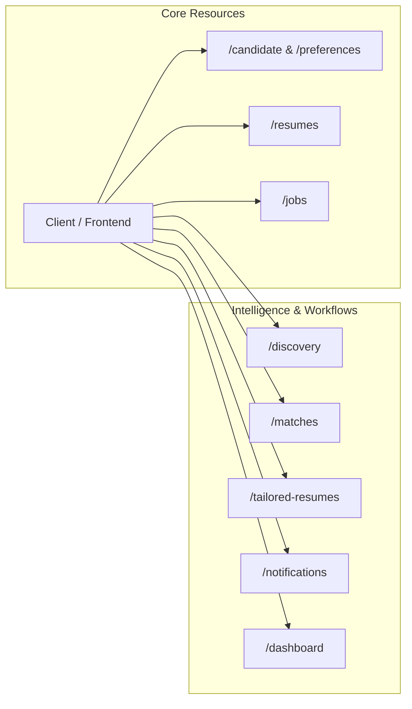

# AI Job Intelligence Platform — REST API Design

**Document ID:** TD-006  
**Status:** Approved Technical Design  
**Date:** 2026-11-04  
**Scope:** RESTful API Conventions, OpenAPI 3.1 Standards, Endpoints, DTO Schemas, and Error Contracts  

---

# 1. API Architecture & Global Conventions

The JobRadar AI backend exposes a clean, predictable **RESTful HTTP API** adhering to OpenAPI 3.1 specifications.

### Global Principles:
- **Base URL & Versioning:** All endpoints are versioned with a URI prefix: `/api/v1/`.
- **JSON Standard:** Payloads use `application/json` with UTF-8 encoding. Field names use `snake_case`.
- **Stateless Communication:** HTTP requests carry all necessary context without depending on sticky server sessions.
- **Resource Naming:** URIs use plural nouns for collections (e.g., `/jobs`, `/resumes`) and standard HTTP verbs for operations.

---

# 2. Cross-Cutting Standards

## 2.1 Standard Pagination Schema
All list endpoints utilize consistent query parameters and envelope responses:

**Query Parameters:**
- `page`: Integer $\ge 1$ (default: `1`).
- `page_size`: Integer between $1$ and $100$ (default: `20`).

**Response Envelope:**
```json
{
  "items": [],
  "pagination": {
    "page": 1,
    "page_size": 20,
    "total_items": 142,
    "total_pages": 8,
    "has_next": true,
    "has_prev": false
  }
}
```

## 2.2 Standard Error Response (RFC 7807 Problem Details)
All client (4xx) and server (5xx) errors return an RFC 7807 compliant error payload:

```json
{
  "type": "https://api.jobradar.ai/v1/errors/validation-error",
  "title": "Unprocessable Entity",
  "status": 422,
  "detail": "The request body failed schema validation.",
  "instance": "/api/v1/resumes/upload",
  "invalid_params": [
    {
      "name": "file_size",
      "reason": "Uploaded file exceeds maximum allowed size of 10MB."
    }
  ],
  "correlation_id": "c9bf9e57-1685-4c89-bafb-ff5af830be8a"
}
```

## 2.3 Authentication & Context Assumption (MVP)
- **MVP Model:** Single-tenant candidate operation. Authentication context is resolved via a configurable API key header (`X-API-Key`) or a mock user dependency (`get_current_user`) returning the primary candidate record.
- **Future Ready:** The dependency interface will swap to standard JWT Bearer tokens (`Authorization: Bearer <token>`) without changing endpoint paths or domain signatures.

## 2.4 Idempotency Headers
Sensitive mutative operations (e.g. triggering discovery runs or resending emails) accept an optional `Idempotency-Key: <UUID>` header. If re-transmitted with the same key within 24 hours, the backend returns the cached prior response without re-executing the operation.

---

# 3. Endpoint Specifications by Resource Group



---

## 3.1 Candidate Profile & Preferences (`/candidate`)

### Endpoints:
| Method | Endpoint | Purpose | Request Body | Response Body |
| :--- | :--- | :--- | :--- | :--- |
| `GET` | `/candidate/profile` | Retrieve the active candidate profile. | None | `CandidateProfileResponse` |
| `PUT` | `/candidate/profile` | Update profile information (summary, headline, city). | `CandidateProfileUpdateRequest` | `CandidateProfileResponse` |
| `GET` | `/candidate/preferences` | Retrieve job search preferences and filters. | None | `CandidatePreferencesResponse` |
| `PUT` | `/candidate/preferences` | Update preferences (min score, locations, titles). | `CandidatePreferencesUpdateRequest` | `CandidatePreferencesResponse` |
| `GET` | `/candidate/skills` | List verified candidate skills. | None | `list[CandidateSkillResponse]` |
| `POST` | `/candidate/skills` | Add or update verified candidate skills. | `CandidateSkillCreateRequest` | `CandidateSkillResponse` |

**Validation Rules:**
- `minimum_relevance_score` must be between `0.00` and `100.00`.
- `preferred_workplace_types` items must be valid enums (`REMOTE`, `HYBRID`, `ONSITE`).
- `max_job_age_days` must be an integer $> 0$.

---

## 3.2 Master Resume Management (`/resumes`)

### Endpoints:
| Method | Endpoint | Purpose | Request Body | Response Body |
| :--- | :--- | :--- | :--- | :--- |
| `GET` | `/resumes` | List all uploaded master resumes. | Query: `page`, `page_size` | `Paginated[MasterResumeSummary]` |
| `POST` | `/resumes/upload` | Upload a new master resume file (PDF or DOCX). | `multipart/form-data` (file) | `MasterResumeDetailResponse` |
| `GET` | `/resumes/{id}` | Get master resume metadata & active version. | None | `MasterResumeDetailResponse` |
| `POST` | `/resumes/{id}/activate`| Set this resume as the active master resume. | None | `MasterResumeDetailResponse` |
| `GET` | `/resumes/{id}/versions`| List all parsed versions for this resume. | None | `list[ResumeVersionResponse]` |
| `GET` | `/resumes/{id}/download`| Download original uploaded resume binary. | None | Binary (`application/pdf` or docx) |

**Validation Rules:**
- Supported MIME types: `application/pdf`, `application/vnd.openxmlformats-officedocument.wordprocessingml.document`.
- File size limit: 10 MB.
- Content sanitized to prevent directory traversal in storage keys.

---

## 3.3 Canonical Jobs (`/jobs`)

### Endpoints:
| Method | Endpoint | Purpose | Request Body | Response Body |
| :--- | :--- | :--- | :--- | :--- |
| `GET` | `/jobs` | Search & filter discovered canonical jobs. | Query: `status`, `workplace_type`, `search`, `page`, `page_size` | `Paginated[JobSummaryResponse]` |
| `GET` | `/jobs/{id}` | Get complete canonical job details. | None | `JobDetailResponse` |
| `GET` | `/jobs/{id}/analysis` | Retrieve structured JD analysis and requirements. | None | `JobAnalysisResponse` |
| `GET` | `/jobs/{id}/sources` | View source provenance records for this job. | None | `list[JobSourceRecordResponse]` |

**Validation Rules:**
- `search` parameter queries title and company using trigram similarity.
- `status` query filter must match valid `job_status_enum`.

---

## 3.4 Discovery Management (`/discovery`)

### Endpoints:
| Method | Endpoint | Purpose | Request Body | Response Body |
| :--- | :--- | :--- | :--- | :--- |
| `GET` | `/discovery/sources` | List all registered job sources. | None | `list[JobSourceResponse]` |
| `PATCH`| `/discovery/sources/{id}`| Toggle enabled state or update polling interval. | `JobSourceUpdateRequest` | `JobSourceResponse` |
| `POST` | `/discovery/sources` | Register a new job source. | `JobSourceCreateRequest` | `JobSourceResponse` |
| `GET` | `/discovery/runs` | List execution history of discovery runs. | Query: `source_id`, `page`, `page_size` | `Paginated[DiscoveryRunResponse]` |
| `POST` | `/discovery/trigger` | Trigger an immediate manual discovery run. | `DiscoveryTriggerRequest` | `DiscoveryRunResponse` |

**Validation Rules:**
- `base_url` must be a valid HTTPS URL.
- `source_type` must match `GREENHOUSE`, `LEVER`, or `CAREER_PAGE`.

---

## 3.5 Matching & Insights (`/matches`)

### Endpoints:
| Method | Endpoint | Purpose | Request Body | Response Body |
| :--- | :--- | :--- | :--- | :--- |
| `GET` | `/matches` | List evaluated job matches sorted by score. | Query: `min_score`, `eligibility`, `page`, `page_size` | `Paginated[JobMatchSummaryResponse]` |
| `GET` | `/matches/{id}` | Get detailed scoring breakdown and reasoning. | None | `JobMatchDetailResponse` |
| `POST` | `/matches/{job_id}/re-evaluate` | Re-run matching against updated candidate profile. | None | `JobMatchDetailResponse` |

**Response Highlights:**
- Detailed breakdown exposes line-item points for required skills, experience alignment, title similarity, and LLM semantic observations.

---

## 3.6 Tailored Resumes (`/tailored-resumes`)

### Endpoints:
| Method | Endpoint | Purpose | Request Body | Response Body |
| :--- | :--- | :--- | :--- | :--- |
| `GET` | `/tailored-resumes` | List all generated job-specific resumes. | Query: `job_id`, `page`, `page_size` | `Paginated[TailoredResumeSummary]` |
| `GET` | `/tailored-resumes/{id}` | Get tailored resume metadata & diff. | None | `TailoredResumeDetailResponse` |
| `GET` | `/tailored-resumes/{id}/download`| Download generated tailored PDF resume. | None | Binary (`application/pdf`) |
| `POST`| `/tailored-resumes/{job_id}/generate`| Manually trigger resume tailoring for a job. | `TailorResumeRequest` | `TailoredResumeDetailResponse` |

**Validation Rules:**
- Only jobs with `status IN ('MATCHED', 'TAILORED')` can generate tailored resumes.
- Download endpoint sets `Content-Disposition: attachment; filename="<Company>_<Role>_Resume.pdf"`.

---

## 3.7 Notifications (`/notifications`)

### Endpoints:
| Method | Endpoint | Purpose | Request Body | Response Body |
| :--- | :--- | :--- | :--- | :--- |
| `GET` | `/notifications` | View email notification delivery history. | Query: `status`, `page`, `page_size` | `Paginated[NotificationResponse]` |
| `POST`| `/notifications/{id}/retry`| Retry a failed email notification. | None | `NotificationResponse` |

**Validation Rules:**
- Retrying an already `DELIVERED` notification returns HTTP 409 Conflict.

---

## 3.8 Dashboard Overview (`/dashboard`)

### Endpoints:
| Method | Endpoint | Purpose | Request Body | Response Body |
| :--- | :--- | :--- | :--- | :--- |
| `GET` | `/dashboard/stats` | Aggregated metrics (jobs discovered, matches, emails). | None | `DashboardStatsResponse` |
| `GET` | `/dashboard/recent-activity` | Chronological activity feed for the UI. | Query: `limit` (default: 10) | `list[ActivityFeedItem]` |

---

## 3.9 Candidate Application Tracking (`/applications`)

### Endpoints:
| Method | Endpoint | Purpose | Request Body | Response Body |
| :--- | :--- | :--- | :--- | :--- |
| `GET` | `/applications` | List candidate-tracked applications. | Query: `status`, `page`, `page_size` | `Paginated[ApplicationResponse]` |
| `POST`| `/applications` | Mark a job as applied or saved. | `ApplicationCreateRequest` | `ApplicationResponse` |
| `PATCH`| `/applications/{id}`| Update status (e.g. `INTERVIEWING`, `OFFER_RECEIVED`) or notes. | `ApplicationUpdateRequest` | `ApplicationResponse` |

---

# 4. HTTP Status Code Conventions

```text
200 OK                  Successful GET or standard mutation
201 Created             Successful resource creation (upload, registration)
202 Accepted            Asynchronous task triggered (manual discovery, tailoring trigger)
204 No Content          Successful deletion or action with no body
400 Bad Request         Malformed syntax or invalid state transition
401 Unauthorized        Missing or invalid authentication credentials
404 Not Found           Resource UUID does not exist
409 Conflict            Resource collision or duplicate idempotency key
422 Unprocessable       Schema validation failure or domain constraint violation
500 Internal Error      Unhandled server exception (alerts monitoring)
502 Bad Gateway         Upstream source adapter or email provider failure
504 Gateway Timeout     LLM inference or third-party HTTP timeout
```

