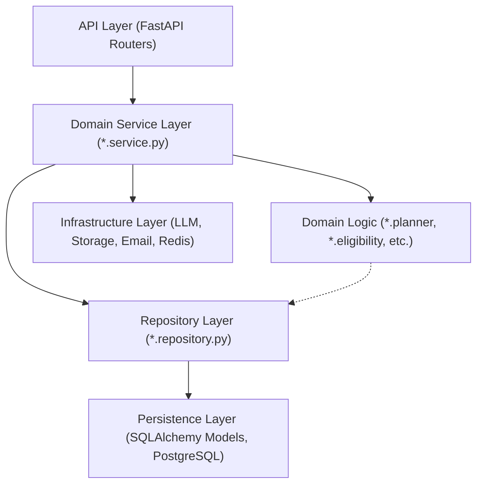
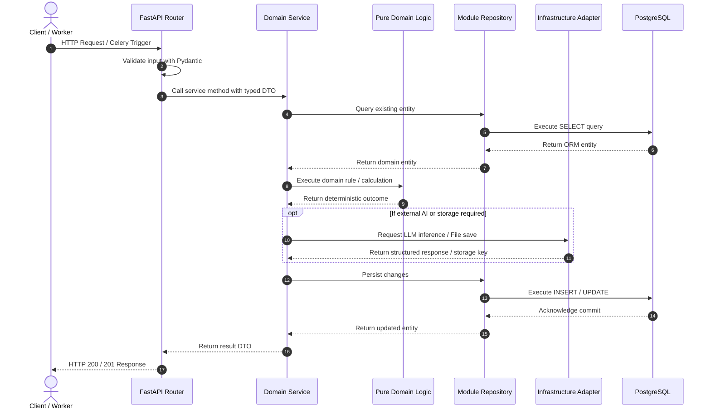

# AI Job Intelligence Platform — Backend Architecture

**Document ID:** TD-002  
**Status:** Approved Technical Design  
**Date:** 2026-11-04  
**Scope:** Modular Monolith Architecture, Layered Boundaries, Dependency Rules, and Directory Layout  

---

# 1. Architectural Style & Philosophy

The JobRadar AI backend is designed as a **Clean Modular Monolith** with an **Asynchronous Task Worker Tier**. 

### Core Architectural Principles:
1. **Separation of Concerns:** Business logic, persistence, HTTP transport, and external integrations reside in strictly delineated layers.
2. **Unidirectional Dependency Flow:** Dependencies point inward toward the core domain. Outer infrastructure and transport layers depend on inner abstractions, never vice-versa.
3. **Encapsulated Domain Modules:** Each business capability (Candidate, Resumes, Jobs, Discovery, Matching, Tailoring, Notifications) forms an autonomous domain module with clear public APIs.
4. **Thin Transport Controllers:** API route handlers perform request parsing, authentication checks, dependency injection, and delegation to domain services. No business calculations or multi-step database mutations occur in route functions.
5. **Dumb Persistence Models:** ORM models represent relational storage schemas and foreign-key constraints only. Domain logic, validation rules, and scoring formulas live in dedicated service and domain classes.
6. **Centralized Provider Abstractions:** LLM inference, object storage, and email delivery are hidden behind protocol interfaces in an `infrastructure` layer, completely decoupling domain logic from third-party vendor APIs.

---

# 2. Recommended Directory Structure

```text
backend/
├── app/
│   ├── __init__.py
│   ├── main.py                     # FastAPI application factory & lifecycle management
│   │
│   ├── api/                        # HTTP Transport Layer
│   │   ├── __init__.py
│   │   ├── dependencies.py         # Global DI (DB sessions, auth context, pagination)
│   │   ├── errors.py               # Global exception handlers (RFC 7807)
│   │   ├── middleware.py           # Correlation IDs, request logging, timing
│   │   └── v1/                     # Versioned API routes
│   │       ├── __init__.py
│   │       ├── router.py           # v1 master router aggregator
│   │       ├── candidate.py        # /candidate & /preferences routes
│   │       ├── resumes.py          # /resumes routes (upload, versions, preview)
│   │       ├── jobs.py             # /jobs routes (list, details, analysis)
│   │       ├── discovery.py        # /discovery routes (sources, runs, triggers)
│   │       ├── matches.py          # /matches routes (insights, explanations)
│   │       ├── tailored.py         # /tailored-resumes routes (PDF download)
│   │       ├── notifications.py    # /notifications routes (history, retry)
│   │       ├── applications.py     # /applications routes (manual status)
│   │       └── dashboard.py        # /dashboard routes (summary metrics)
│   │
│   ├── core/                       # Cross-Cutting Foundations
│   │   ├── __init__.py
│   │   ├── config.py               # Pydantic BaseSettings (env-driven)
│   │   ├── logging.py              # Structured JSON logging configuration
│   │   ├── exceptions.py           # Base domain and infrastructure exceptions
│   │   └── security.py             # Sanitization, path traversal checks, tokens
│   │
│   ├── database/                   # Relational Persistence Engine
│   │   ├── __init__.py
│   │   ├── session.py              # AsyncSessionmaker, engine setup, pooling
│   │   ├── base.py                 # DeclarativeBase, common timestamp mixins
│   │   └── unit_of_work.py         # Transactional unit of work abstraction
│   │
│   ├── infrastructure/             # External Gateway Implementations
│   │   ├── __init__.py
│   │   ├── storage/                # File Storage Providers
│   │   │   ├── base.py             # FileStorage protocol interface
│   │   │   ├── local.py            # Local filesystem storage implementation
│   │   │   └── s3.py               # S3-compatible cloud storage adapter (future)
│   │   ├── llm/                    # Language Model Providers
│   │   │   ├── base.py             # LLMProvider protocol & options schema
│   │   │   ├── ollama.py           # Ollama HTTP API provider
│   │   │   └── openai_compat.py    # OpenAI / Claude / vLLM provider
│   │   ├── email/                  # Notification Providers
│   │   │   ├── base.py             # EmailProvider protocol interface
│   │   │   ├── smtp.py             # SMTP provider (local Mailpit / production)
│   │   │   └── mock.py             # In-memory test provider
│   │   └── queue/                  # Celery Instance Configuration
│   │       ├── celery_app.py       # Celery broker/backend setup
│   │       └── router.py           # Queue routing rules & task definitions
│   │
│   ├── modules/                    # Core Domain Capabilities
│   │   │
│   │   ├── candidate/              # Candidate Profile & Preferences
│   │   │   ├── models.py           # candidate_profiles, preferences, skills
│   │   │   ├── schemas.py          # Pydantic request/response models
│   │   │   ├── repository.py       # Candidate database access
│   │   │   └── service.py          # Profile validation and preference management
│   │   │
│   │   ├── resumes/                # Master Resumes & Versioning
│   │   │   ├── models.py           # master_resumes, resume_versions
│   │   │   ├── schemas.py          # Structured resume content models
│   │   │   ├── repository.py       # Resume queries and version management
│   │   │   ├── parsers/            # PDF and DOCX structural extraction
│   │   │   │   ├── pdf_parser.py   # pdfplumber bounding-box parser
│   │   │   │   └── docx_parser.py  # python-docx structural parser
│   │   │   ├── rendering/          # Resume PDF Generation
│   │   │   │   ├── engine.py       # Rendering strategy coordinator
│   │   │   │   ├── template_preserver.py # Style-preserved HTML/CSS compiler
│   │   │   │   └── fallback_renderer.py  # Standardized ATS HTML/CSS compiler
│   │   │   └── service.py          # Resume lifecycle orchestration
│   │   │
│   │   ├── discovery/              # Job Source Harvesting
│   │   │   ├── models.py           # job_sources, discovery_runs
│   │   │   ├── schemas.py          # Discovery DTOs and source configuration
│   │   │   ├── repository.py       # Discovery run queries and persistence
│   │   │   ├── adapters/           # Source Adapter Implementations
│   │   │   │   ├── base.py         # JobSourceAdapter base interface
│   │   │   │   ├── registry.py     # Source adapter dynamic registry
│   │   │   │   ├── greenhouse.py   # Greenhouse public API adapter
│   │   │   │   ├── lever.py        # Lever public API adapter
│   │   │   │   └── career_page.py  # Permitted Career Page adapter
│   │   │   └── service.py          # Discovery run coordination
│   │   │
│   │   ├── jobs/                   # Canonical Jobs & Normalization
│   │   │   ├── models.py           # jobs, job_source_records
│   │   │   ├── schemas.py          # Canonical and Normalized Job schemas
│   │   │   ├── repository.py       # Job search, deduplication queries
│   │   │   ├── normalizer.py       # Title, company, location cleaning rules
│   │   │   ├── deduplicator.py     # Hashing & canonical matching logic
│   │   │   └── service.py          # Ingestion and canonicalization service
│   │   │
│   │   ├── analysis/               # Job Description Intelligence
│   │   │   ├── models.py           # job_analysis table mapping
│   │   │   ├── schemas.py          # Structured JD requirements schemas
│   │   │   ├── repository.py       # Analysis persistence
│   │   │   ├── prompts.py          # Strict extraction prompt templates
│   │   │   └── service.py          # LLM-assisted JD analysis coordinator
│   │   │
│   │   ├── matching/               # Hybrid Scoring Engine
│   │   │   ├── models.py           # job_matches table mapping
│   │   │   ├── schemas.py          # Match scores and breakdown schemas
│   │   │   ├── repository.py       # Match record persistence
│   │   │   ├── eligibility.py      # Layer 1: Deterministic rule validator
│   │   │   ├── weighted_scorer.py  # Layer 2: Deterministic weighted calculations
│   │   │   ├── semantic_evaluator.py # Layer 3: LLM contextual evaluator
│   │   │   ├── skill_normalizer.py # Skill alias dictionary & taxonomies
│   │   │   └── service.py          # 3-layer matching orchestration
│   │   │
│   │   ├── tailoring/              # Resume Optimization & Evidence Guard
│   │   │   ├── models.py           # tailored_resumes table mapping
│   │   │   ├── schemas.py          # Tailoring plan & diff schemas
│   │   │   ├── repository.py       # Tailored resume queries
│   │   │   ├── evidence_vault.py   # Candidate truth extraction & indexing
│   │   │   ├── planner.py          # Section-by-section tailoring plan builder
│   │   │   ├── rewriter.py         # LLM-assisted bullet rephrasing
│   │   │   ├── validator.py        # Fact-checking against evidence vault
│   │   │   └── service.py          # End-to-end tailoring pipeline
│   │   │
│   │   ├── notifications/          # Alert Dispatch & Email Delivery
│   │   │   ├── models.py           # notification_deliveries table
│   │   │   ├── schemas.py          # Notification DTOs
│   │   │   ├── repository.py       # Idempotency and delivery queries
│   │   │   ├── email_builder.py    # HTML email formatting with match metrics
│   │   │   └── service.py          # Notification dispatch & deduplication
│   │   │
│   │   └── applications/           # Candidate Application Tracking
│   │       ├── models.py           # applications table
│   │       ├── schemas.py          # Application status DTOs
│   │       ├── repository.py       # Application queries
│   │       └── service.py          # Status transition management
│   │
│   └── workers/                    # Celery Background Execution Tasks
│       ├── __init__.py
│       ├── discovery_tasks.py      # Run source discovery jobs
│       ├── processing_tasks.py     # Normalization, deduplication, matching
│       ├── tailoring_tasks.py      # JD analysis, tailoring, PDF rendering
│       └── notification_tasks.py   # Immediate email dispatch & retries
│
├── tests/                          # Automated Test Suite
│   ├── unit/                       # Fast isolated tests
│   ├── integration/                # Database and API integration tests
│   ├── contract/                   # Provider and adapter contract tests
│   └── e2e/                        # End-to-end pipeline workflow tests
│
├── alembic/                        # Database Migration Environment
│   ├── versions/                   # Migration script revisions
│   └── env.py                      # Alembic async migration runner
│
├── pyproject.toml                  # Dependencies, build system, tool configs
└── alembic.ini                     # Alembic configuration file
```

---

# 3. Layered Architecture & Dependency Rules

To prevent code degradation, the system enforces strict boundaries between layers.



## 3.1 Layer Responsibilities & Permitted Interactions

| Layer | Responsibility | Allowed Dependencies | Prohibited Dependencies |
| :--- | :--- | :--- | :--- |
| **API Layer** (`app/api/`) | Receives HTTP requests, validates input DTOs via Pydantic, checks auth/context, calls domain services, returns standard responses. | Domain Services, Core (Exceptions, Config), API Schemas, Dependencies. | Direct DB queries, ORM models, direct LLM calls, background worker tasks directly without service. |
| **Domain Service Layer** (`modules/*/service.py`) | Orchestrates multi-step business transactions, coordinates repositories, triggers domain logic, schedules background tasks. | Repositories, Domain Logic, Infrastructure Clients (Storage, LLM, Email), Core Config. | FastAPI classes (`Request`, `Response`, `HTTPException`), raw HTTP handling. |
| **Pure Domain Logic** (`modules/*/{planner, normalizer, etc.}`) | Deterministic business rules, scoring calculations, evidence verification, resume diffing, template generation. | Pure Python, Pydantic schemas, Core utils. **Pure computation.** | Database connections, SQLAlchemy models, I/O operations, network clients. |
| **Repository Layer** (`modules/*/repository.py`) | Executes SQL queries, abstracts ORM operations, translates DB exceptions to domain errors. | SQLAlchemy `AsyncSession`, ORM Models, Core Exceptions. | Business logic, scoring rules, LLM providers, API controllers. |
| **Infrastructure Layer** (`app/infrastructure/`) | Implements adapters for external systems (Ollama, SMTP, S3/disk, Celery queue). | Core Config, external client libraries (`httpx`, `weasyprint`, `aiosmtplib`). | Domain Services, HTTP Routers, Application state. |
| **Persistence Layer** (`modules/*/models.py`, `database/`) | Defines relational schema mapping, table constraints, relationships, and connection lifecycle. | SQLAlchemy DeclarativeBase. | Business rules, calculations, external APIs. |

---

# 4. Prohibited Architectural Patterns

1. **No "Fat Controllers":** Route handlers in `app/api/` must never contain business logic, manual database queries, or scoring algorithms. A route handler's length should rarely exceed 25 lines of code.
2. **No Logic in Models:** SQLAlchemy models must only define table columns, constraints, foreign keys, and relationships. They must not contain data fetching methods or transformation logic.
3. **No Direct LLM Invocations in Modules:** Domain modules must never import `httpx` or Ollama libraries directly. All LLM operations must call `LLMProvider` abstractions defined in `infrastructure/llm/`.
4. **No Direct Adapter-to-Database Coupling:** Source adapters (`GreenhouseAdapter`, `LeverAdapter`) must return normalized DTOs (`RawDiscoveredJob`). They must never accept a database session or write directly to PostgreSQL.
5. **No Cross-Module Database Mutations:** The `discovery` module cannot write to `job_matches`. The `matching` module cannot write to `tailored_resumes`. Inter-module workflows must be coordinated either by high-level pipeline tasks or via domain service boundaries.
6. **No Circular Dependencies:** Domain modules must never import each other bidirectionally. Shared DTOs or entities must be coordinated through parent services or common schema definitions.

---

# 5. Data Flow Across the Backend

The following sequence illustrates the strict flow of data from an HTTP client or background worker through the backend layers:



---

# 6. Error Handling & Exception Hierarchy

To ensure uniform error responses and prevent internal stack traces from leaking to clients, the backend implements a centralized exception handling architecture:

```text
AppException (Base)
├── DomainException (400 / 422)
│   ├── EntityNotFoundError (404)
│   ├── EntityAlreadyExistsError (409)
│   ├── EligibilityRuleFailedError (422)
│   ├── ResumeEvidenceMismatchError (422)
│   └── InvalidStateTransitionError (400)
│
└── InfrastructureException (500 / 502 / 504)
    ├── ExternalSourceUnavailableError (502)
    ├── LLMProviderTimeoutError (504)
    ├── StorageWriteFailureError (500)
    └── EmailDeliveryFailureError (502)
```

- **Domain Exceptions:** Raised by domain services and caught by global exception handlers in `app/api/errors.py`. They translate directly into standard RFC 7807 problem details payloads.
- **Infrastructure Exceptions:** Encapsulate transient network failures, timeouts, and third-party crashes. Background workers catch these exceptions and trigger Celery's exponential backoff retry mechanics.

---

# 7. Modularity & Scalability Trade-offs

### Why Modular Monolith for MVP?
- **Cognitive Load:** Developers work within a single repository, single type system, and single database.
- **Transactional Integrity:** Complex operations (e.g., creating a canonical job and its source record simultaneously) execute within standard ACID database transactions, avoiding distributed two-phase commits.
- **Fast Local Development:** The entire application runs locally with minimal container overhead.

### Future Extraction Path
Because domain modules maintain strict boundaries, encapsulate their own models, and communicate via explicit service interfaces:
- The `tailoring` module (LLM inference + WeasyPrint PDF compilation) can be extracted into an independent GPU-optimized microservice in less than two engineering sprints if processing demands dictate.
- The `discovery` module can be extracted into an isolated polling fleet without altering the core matching or tailoring codebase.

