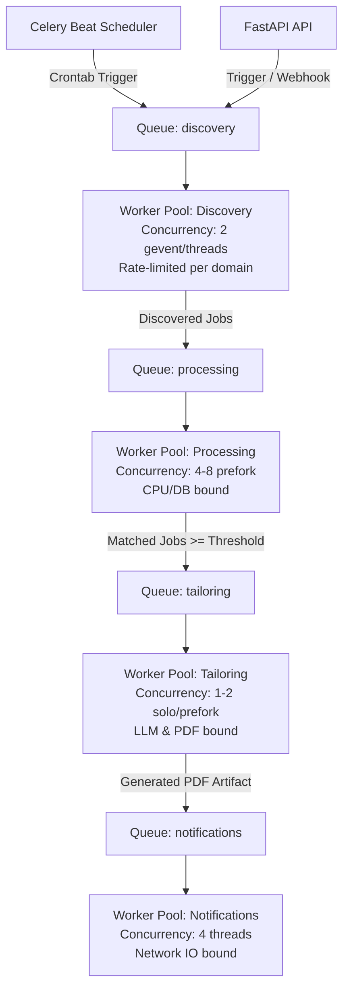

# AI Job Intelligence Platform — Background Task & Worker Architecture

**Document ID:** TD-007  
**Status:** Approved Technical Design  
**Date:** 2026-11-04  
**Scope:** Celery Queue Topology, Worker Concurrency, Task Idempotency, Retries, and Coordination  

---

# 1. Executive Summary & Design Principles

The JobRadar AI platform decouples HTTP request handling from computational and I/O-intensive operations through a robust asynchronous background processing tier powered by **Celery** and **Redis**.

### Core Asynchronous Principles:
1. **Zero Long-Running API Requests:** Operations exceeding 200 milliseconds (scraping external sources, LLM structured extraction, WeasyPrint PDF compilation, and SMTP delivery) are strictly asynchronous.
2. **Dedicated Queue Segregation:** Tasks are isolated into distinct queues based on resource profiles (I/O-bound vs CPU/GPU-bound) to prevent resource starvation.
3. **Strict Idempotency:** Every task can be retried safely without duplicating database records, generating duplicate resumes, or spamming candidates with duplicate emails.
4. **Resilient Failure Handling:** Transient network errors are retried using exponential backoff with jitter; permanent business logic errors fail fast and log actionable diagnostic summaries.
5. **Durable State Tracking:** Background workers update state in PostgreSQL at every milestone, ensuring total system observability.

---

# 2. Synchronous vs Asynchronous Operations

| Operation | Execution Model | Rationale |
| :--- | :--- | :--- |
| **Profile & Preferences CRUD** | **Synchronous** | Fast database I/O (< 15ms); user requires immediate confirmation. |
| **Resume Binary Upload** | **Synchronous** | Validates file header and writes raw binary to storage (< 50ms). |
| **Resume Text & Structural Parsing** | **Asynchronous** | Heavy PDF text and bounding-box extraction; can take 1-3 seconds. |
| **Job Discovery (Polling Sources)** | **Asynchronous** | External HTTP calls across multiple ATS portals; rate-limited. |
| **Job Normalization & Deduplication**| **Asynchronous** | Batched pipeline execution; ensures high-throughput ingestion. |
| **Deterministic Matching (L1 & L2)** | **Asynchronous** | Chained following job deduplication; evaluates multiple jobs. |
| **Job Description Analysis (LLM)** | **Asynchronous** | LLM inference takes 3-10 seconds per job. |
| **LLM Semantic Evaluation (L3)** | **Asynchronous** | Contextual inference; latency-heavy. |
| **Resume Tailoring Plan & Rewriting**| **Asynchronous** | Multi-step LLM bullet generation and claim verification. |
| **PDF Compilation (WeasyPrint)** | **Asynchronous** | CSS layout rendering and font embedding takes 1-2 seconds. |
| **Email Delivery (SMTP)** | **Asynchronous** | External mail server connection and PDF attachment upload. |
| **Application Status Tracking** | **Synchronous** | Fast user status update (< 10ms). |

---

# 3. Queue Topology & Worker Concurrency

To ensure optimal resource utilization and prevent LLM or PDF rendering from blocking fast email alerts, workers are partitioned across **four dedicated queues**:

### Queue Configurations:

| Queue Name | Primary Tasks | Concurrency Pool | Rationale |
| :--- | :--- | :--- | :--- |
| **`discovery`** | Source polling, crawling | 2 (threads / eventlet) | Low concurrency to strictly honor upstream ATS rate limits. |
| **`processing`**| Normalization, deduplication, deterministic matching | 4–8 (prefork) | CPU-bound text processing and high-throughput PostgreSQL queries. |
| **`tailoring`** | JD extraction, LLM tailoring, WeasyPrint PDF compilation | 1–2 (solo / prefork) | Protects local GPU/CPU from Ollama overload; limits peak memory during PDF layout. |
| **`notifications`**| HTML email formatting, SMTP transmission | 4 (threads) | Network I/O-bound; fast delivery of candidate alerts. |

---

# 4. Detailed Task Specifications

## 4.1 Task: `discover_source_jobs_task`
- **Queue:** `discovery`
- **Trigger:** Celery Beat schedule (e.g., every 6 hours) or manual API trigger (`POST /discovery/trigger`).
- **Input:** `job_source_id: UUID`.
- **Idempotency Key:** `discovery:{source_id}:{YYYY-MM-DD-HH}`.
- **Workflow:**
  1. Fetch source adapter configuration from `job_sources`.
  2. Acquire Redis rate-limit token for upstream domain.
  3. Execute adapter `fetch_jobs()`.
  4. Record `discovery_runs` row with `status = 'RUNNING'`.
  5. For each raw job discovered, dispatch `process_discovered_job_task.delay(raw_payload)`.
  6. Update `discovery_runs` with metrics and `status = 'COMPLETED'`.
- **Retry Policy:** Max 3 retries. Exponential backoff: 30s, 60s, 120s.
- **Timeout:** Soft limit: 300s; Hard limit: 360s.
- **Failure Behavior:** Mark `discovery_runs.status = 'FAILED'`, record `error_summary`.

## 4.2 Task: `process_discovered_job_task`
- **Queue:** `processing`
- **Trigger:** Dispatched by `discover_source_jobs_task`.
- **Input:** `raw_payload: dict`, `job_source_id: UUID`.
- **Idempotency Key:** `job_ingest:{source_id}:{external_job_id}`.
- **Workflow:**
  1. Clean text and normalize location/workplace type.
  2. Strip tracking parameters from application URL.
  3. Compute canonical `dedup_fingerprint_sha256`.
  4. Perform atomic upsert:
     - If job exists: Update `last_seen_at`.
     - If new job: Insert into `jobs` table (`status = 'DISCOVERED'`), insert into `job_source_records`.
     - Dispatch `evaluate_job_matching_task.delay(job_id)`.
- **Retry Policy:** Zero retries on validation errors; 3 retries on database deadlock.
- **Timeout:** Soft limit: 30s; Hard limit: 45s.
- **Failure Behavior:** Log dropped payload to dead-letter storage.

## 4.3 Task: `evaluate_job_matching_task`
- **Queue:** `processing`
- **Trigger:** Dispatched after job canonicalization or candidate preference update.
- **Input:** `job_id: UUID`, `candidate_profile_id: UUID`.
- **Idempotency Key:** `matching:{job_id}:{candidate_profile_id}`.
- **Workflow:**
  1. Evaluate Layer 1 Deterministic Eligibility (Location, workplace type, experience threshold).
     - If failed: Update `job_matches.eligibility_status`, mark `jobs.status = 'ELIGIBILITY_FAILED'`. Halt.
  2. Evaluate Layer 2 Deterministic Weighted Scoring (Skills, experience, title, workplace).
  3. If `deterministic_score < 50.00`:
     - Mark `jobs.status = 'REJECTED'`, persist score breakdown. Halt.
  4. If `deterministic_score >= 50.00`:
     - Dispatch `tailor_and_notify_pipeline_task.delay(job_id, candidate_profile_id)`.
- **Retry Policy:** 3 retries with 5s backoff.
- **Timeout:** Soft limit: 20s; Hard limit: 30s.

## 4.4 Task: `tailor_and_notify_pipeline_task`
- **Queue:** `tailoring`
- **Trigger:** Dispatched when a job passes preliminary matching.
- **Input:** `job_id: UUID`, `candidate_profile_id: UUID`.
- **Idempotency Key:** `tailoring:{job_id}:{active_resume_version_id}`.
- **Workflow:**
  1. **Acquire Distributed Lock:** `lock:tailoring:{job_id}` with TTL = 180s.
  2. **JD Analysis:** Call LLM to extract structured skills and responsibilities; persist `job_analysis`.
  3. **Layer 3 Semantic Match:** Call LLM for contextual alignment and transferable skills.
  4. Compute `final_score`. If `final_score < minimum_relevance_score`, mark `jobs.status = 'REJECTED'` and release lock.
  5. **Resume Tailoring:**
     - Extract candidate evidence vault.
     - Generate tailoring plan; rephrase bullets truthfully.
     - Validate claims against evidence vault.
  6. **PDF Compilation:**
     - Determine template strategy (preservation vs fallback).
     - Render PDF via WeasyPrint; verify binary integrity and checksum.
     - Persist `tailored_resumes` record.
  7. **Dispatch Notification:**
     - Queue `send_email_notification_task.delay(job_id, tailored_resume_id)`.
  8. Release distributed lock.
- **Retry Policy:** 2 retries on LLM timeout (backoff: 15s).
- **Timeout:** Soft limit: 180s; Hard limit: 240s.
- **Failure Behavior:** If claim validation or PDF render fails, mark `tailored_resumes.generation_status = 'FAILED'`, update `jobs.status = 'MATCHED'` (allows manual re-trigger).

## 4.5 Task: `send_email_notification_task`
- **Queue:** `notifications`
- **Trigger:** Dispatched after PDF generation succeeds.
- **Input:** `job_id: UUID`, `tailored_resume_id: UUID`, `recipient_email: str`.
- **Idempotency Key:** `email:{job_id}:{recipient_email}`.
- **Workflow:**
  1. Check `notification_deliveries` table. If already `status = 'DELIVERED'`, exit immediately.
  2. Fetch job details, match breakdown, and tailored PDF binary.
  3. Format HTML email with match metrics and application link.
  4. Attach PDF binary (`Content-Type: application/pdf`).
  5. Transmit via `EmailProvider.send()`.
  6. Insert / update `notification_deliveries` (`status = 'DELIVERED'`, `sent_at = NOW()`).
  7. Update `jobs.status = 'NOTIFIED'`.
- **Retry Policy:** 5 retries with exponential backoff and jitter (`countdown = min(10 * (2 ** retry_count) + random.uniform(1, 10), 300)`).
- **Timeout:** Soft limit: 30s; Hard limit: 45s.
- **Failure Behavior:** Update `notification_deliveries` with `last_error` and `status = 'FAILED'`.

---

# 5. Prevention of Duplicate Operations & Race Conditions

## 5.1 Preventing Duplicate Job Ingestion
- Upstream source deduplication is enforced by the database unique constraint:
  `UNIQUE (job_source_id, external_job_id)`.
- Cross-source canonical deduplication is enforced by:
  `UNIQUE (dedup_fingerprint_sha256)` on `jobs`.
- Any insert collision causes PostgreSQL to execute `ON CONFLICT DO UPDATE SET last_seen_at = NOW()`.

## 5.2 Preventing Duplicate Resume Generation
- A candidate only receives one tailored resume per active master resume version:
  `UNIQUE (job_id, resume_version_id)` on `tailored_resumes`.
- Before invoking the LLM, the worker checks if a valid tailored resume record already exists on disk. If found, regeneration is bypassed.
- Concurrency race conditions between workers are prevented by acquiring a Redis distributed lock (`SET lock:tailoring:{job_id} {uuid} NX EX 180`).

## 5.3 Preventing Duplicate Emails
- Enforced at the database level:
  `UNIQUE (job_id, recipient_email)` on `notification_deliveries`.
- Even if the Celery worker restarts midway through transmission, subsequent retries perform a pre-flight query checking `status = 'DELIVERED'`. If already delivered, the task terminates immediately without sending a second email.

---

# 6. Dead Letter Queue & Operational Observability

1. **Dead Letter Queue (`dlq`):**
   - Tasks that exhaust their maximum retry count are routed to a `dead_letter` queue in Redis.
   - Dead letter events trigger a structured error log containing the correlation ID, task name, arguments, and full stack trace.
2. **Task Health & Monitoring:**
   - **Flower:** Web-based Celery monitoring tool deployed alongside Redis for inspecting real-time worker pool states, queue depths, and execution latencies.
   - **Structured Task Logging:** Every task invocation generates structured JSON logs capturing:
     `task_name`, `task_id`, `correlation_id`, `job_id`, `duration_ms`, `attempt_number`, `status`.

