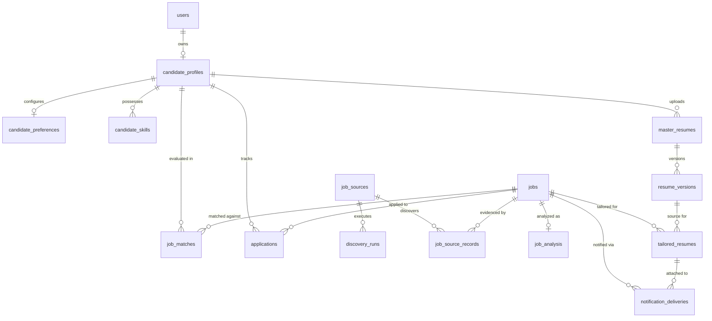
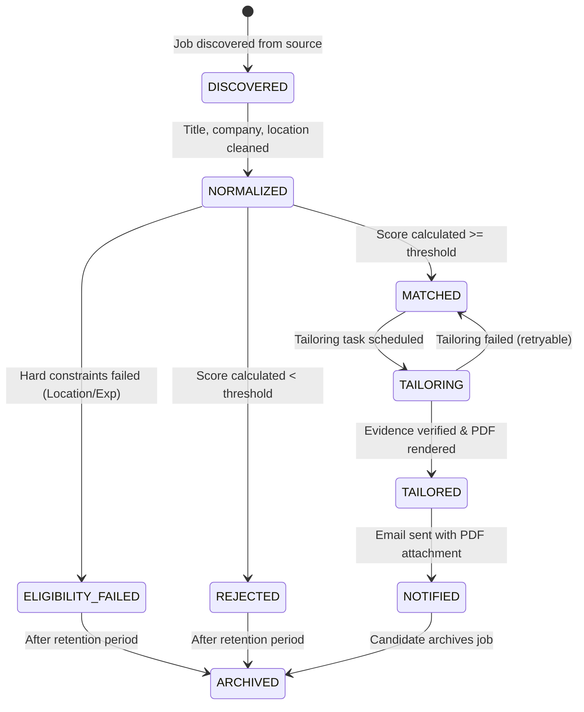

# AI Job Intelligence Platform — Detailed Database Schema Specification

**Document ID:** TD-003  
**Status:** Approved Technical Design  
**Date:** 2026-11-04  
**Scope:** PostgreSQL 16 Relational Schema, Tables, Constraints, Indexes, Enums, and State Machines  

---

# 1. Executive Summary & Design Principles

This document translates the conceptual database design into an **implementation-ready PostgreSQL 16 schema specification**. 

### Core Schema Principles:
1. **Durable Source of Truth:** PostgreSQL is the definitive system of record. Ephemeral queues or caches never store unreproducible business history.
2. **Strict Foreign Key Constraints:** Relational integrity is enforced at the database level with explicit `ON DELETE` rules (`CASCADE` or `RESTRICT`).
3. **Immutability of Master Data:** Master resume source files and raw discovery payloads are immutable. Tailored resumes are recorded as discrete, versioned artifacts.
4. **Idempotency Guarantees:** Compound unique constraints guarantee that discovery, matching, resume generation, and notification steps can be retried without creating duplicates.
5. **Auditing & Timestamps:** Every table includes standardized `created_at` and `updated_at` timestamps using UTC (`TIMESTAMPTZ`).
6. **Explicit Enum & State Validation:** Processing states and domain categories are strictly validated using PostgreSQL `ENUM` types or table-level `CHECK` constraints.

---

# 2. Entity-Relationship Diagram (Physical Model)



---

# 3. Enumerated Types (PostgreSQL ENUMs)

```sql
-- Source provider platform
CREATE TYPE job_source_type_enum AS ENUM (
    'GREENHOUSE',
    'LEVER',
    'CAREER_PAGE',
    'MANUAL_FEED'
);

-- Execution status for discovery runs
CREATE TYPE discovery_run_status_enum AS ENUM (
    'PENDING',
    'RUNNING',
    'COMPLETED',
    'FAILED',
    'PARTIAL'
);

-- Canonical job processing lifecycle
CREATE TYPE job_status_enum AS ENUM (
    'DISCOVERED',
    'NORMALIZED',
    'ELIGIBILITY_FAILED',
    'MATCHED',
    'REJECTED',
    'TAILORING',
    'TAILORED',
    'NOTIFIED',
    'ARCHIVED'
);

-- Employment classification
CREATE TYPE employment_type_enum AS ENUM (
    'FULL_TIME',
    'PART_TIME',
    'CONTRACT',
    'INTERNSHIP',
    'TEMPORARY',
    'UNKNOWN'
);

-- Workplace arrangement
CREATE TYPE workplace_type_enum AS ENUM (
    'REMOTE',
    'HYBRID',
    'ONSITE',
    'UNKNOWN'
);

-- Eligibility evaluation outcome
CREATE TYPE eligibility_status_enum AS ENUM (
    'ELIGIBLE',
    'INELIGIBLE_EXPERIENCE',
    'INELIGIBLE_LOCATION',
    'INELIGIBLE_WORK_AUTH',
    'INELIGIBLE_MANDATORY_SKILL'
);

-- Resume tailoring rendering mode
CREATE TYPE rendering_strategy_enum AS ENUM (
    'ORIGINAL_TEMPLATE',
    'STANDARD_FALLBACK'
);

-- Tailored resume generation state
CREATE TYPE tailored_resume_status_enum AS ENUM (
    'PENDING',
    'GENERATING',
    'RENDERED',
    'VALIDATED',
    'FAILED'
);

-- Email delivery status
CREATE TYPE notification_status_enum AS ENUM (
    'QUEUED',
    'SENDING',
    'DELIVERED',
    'FAILED',
    'BOUNCED',
    'SKIPPED'
);

-- Candidate manual application status
CREATE TYPE application_status_enum AS ENUM (
    'SAVED',
    'APPLIED',
    'INTERVIEWING',
    'OFFER_RECEIVED',
    'REJECTED',
    'WITHDRAWN'
);
```

---

# 4. Table Specifications

## 4.1 `users`
**Purpose:** Core user account and authentication record.

| Column | Type | Nullable | Default | Constraints & Description |
| :--- | :--- | :--- | :--- | :--- |
| `id` | `UUID` | No | `gen_random_uuid()` | Primary Key |
| `email` | `VARCHAR(255)` | No | None | Unique, validated email address |
| `is_active` | `BOOLEAN` | No | `TRUE` | Soft-disable flag |
| `created_at` | `TIMESTAMPTZ` | No | `NOW()` | Record creation timestamp |
| `updated_at` | `TIMESTAMPTZ` | No | `NOW()` | Last update timestamp |

**Indexes & Constraints:**
- `CONSTRAINT uq_users_email UNIQUE (email)`

---

## 4.2 `candidate_profiles`
**Purpose:** Structured professional identity for the candidate.

| Column | Type | Nullable | Default | Constraints & Description |
| :--- | :--- | :--- | :--- | :--- |
| `id` | `UUID` | No | `gen_random_uuid()` | Primary Key |
| `user_id` | `UUID` | No | None | Foreign Key → `users(id)` ON DELETE CASCADE |
| `full_name` | `VARCHAR(150)` | No | None | Candidate full legal/professional name |
| `headline` | `VARCHAR(255)` | Yes | `NULL` | Professional headline (e.g., "Senior Python Engineer") |
| `professional_summary` | `TEXT` | Yes | `NULL` | Executive profile summary |
| `current_role` | `VARCHAR(150)` | Yes | `NULL` | Most recent job title |
| `total_experience_months` | `INTEGER` | No | `0` | Calculated total work experience in months |
| `city` | `VARCHAR(100)` | Yes | `NULL` | Primary residence city |
| `country` | `VARCHAR(100)` | Yes | `NULL` | Primary residence country |
| `work_authorization` | `VARCHAR(50)` | Yes | `NULL` | Work eligibility (e.g. "US Citizen", "Green Card", "Tier 2") |
| `created_at` | `TIMESTAMPTZ` | No | `NOW()` | Record creation timestamp |
| `updated_at` | `TIMESTAMPTZ` | No | `NOW()` | Last update timestamp |

**Indexes & Constraints:**
- `CONSTRAINT uq_candidate_profiles_user_id UNIQUE (user_id)`
- `CONSTRAINT chk_total_experience_non_negative CHECK (total_experience_months >= 0)`

---

## 4.3 `candidate_preferences`
**Purpose:** Job matching preferences, filters, and relevance thresholds.

| Column | Type | Nullable | Default | Constraints & Description |
| :--- | :--- | :--- | :--- | :--- |
| `id` | `UUID` | No | `gen_random_uuid()` | Primary Key |
| `candidate_profile_id` | `UUID` | No | None | Foreign Key → `candidate_profiles(id)` ON DELETE CASCADE |
| `minimum_relevance_score`| `NUMERIC(5,2)` | No | `70.00` | Minimum score to qualify for tailoring (0.00 to 100.00) |
| `preferred_titles` | `TEXT[]` | No | `'{}'` | Target titles (e.g. `['Backend Engineer', 'Platform Engineer']`) |
| `preferred_workplace_types`| `workplace_type_enum[]`| No | `'{REMOTE, HYBRID}'` | Acceptable workplace types |
| `preferred_locations` | `TEXT[]` | No | `'{}'` | Target cities/regions |
| `preferred_employment_types`| `employment_type_enum[]`| No | `'{FULL_TIME}'` | Desired contract types |
| `max_job_age_days` | `INTEGER` | No | `14` | Discard jobs older than N days |
| `created_at` | `TIMESTAMPTZ` | No | `NOW()` | Record creation timestamp |
| `updated_at` | `TIMESTAMPTZ` | No | `NOW()` | Last update timestamp |

**Indexes & Constraints:**
- `CONSTRAINT uq_candidate_preferences_profile UNIQUE (candidate_profile_id)`
- `CONSTRAINT chk_relevance_score_range CHECK (minimum_relevance_score BETWEEN 0.00 AND 100.00)`
- `CONSTRAINT chk_job_age_positive CHECK (max_job_age_days > 0)`

---

## 4.4 `candidate_skills`
**Purpose:** Normalized list of verified candidate skills for fast deterministic matching.

| Column | Type | Nullable | Default | Constraints & Description |
| :--- | :--- | :--- | :--- | :--- |
| `id` | `UUID` | No | `gen_random_uuid()` | Primary Key |
| `candidate_profile_id` | `UUID` | No | None | Foreign Key → `candidate_profiles(id)` ON DELETE CASCADE |
| `skill_name` | `VARCHAR(100)` | No | None | Normalized skill name (lowercase, e.g. "postgresql") |
| `category` | `VARCHAR(50)` | No | `'general'` | Category: language, framework, database, cloud, devops |
| `experience_months` | `INTEGER` | No | `0` | Demonstrated months with this skill |
| `is_core` | `BOOLEAN` | No | `FALSE` | High-priority skill designation |
| `created_at` | `TIMESTAMPTZ` | No | `NOW()` | Creation timestamp |

**Indexes & Constraints:**
- `CONSTRAINT uq_candidate_skill UNIQUE (candidate_profile_id, skill_name)`
- `CREATE INDEX idx_candidate_skills_lookup ON candidate_skills (candidate_profile_id, skill_name)`

---

## 4.5 `master_resumes`
**Purpose:** Metadata and pointer to original uploaded resume files (immutable files).

| Column | Type | Nullable | Default | Constraints & Description |
| :--- | :--- | :--- | :--- | :--- |
| `id` | `UUID` | No | `gen_random_uuid()` | Primary Key |
| `candidate_profile_id` | `UUID` | No | None | Foreign Key → `candidate_profiles(id)` ON DELETE CASCADE |
| `original_filename` | `VARCHAR(255)` | No | None | File name provided upon upload |
| `storage_key` | `VARCHAR(512)` | No | None | Storage location (e.g. `resumes/raw/<uuid>.pdf`) |
| `mime_type` | `VARCHAR(100)` | No | None | MIME type (`application/pdf`, `application/vnd.openxmlformats...`) |
| `file_size_bytes` | `BIGINT` | No | None | Upload file size in bytes |
| `checksum_sha256` | `CHAR(64)` | No | None | SHA256 integrity hash of raw file |
| `is_active` | `BOOLEAN` | No | `TRUE` | Whether this is the active master resume |
| `created_at` | `TIMESTAMPTZ` | No | `NOW()` | Upload timestamp |
| `updated_at` | `TIMESTAMPTZ` | No | `NOW()` | Metadata update timestamp |

**Indexes & Constraints:**
- `CREATE INDEX idx_master_resumes_active ON master_resumes (candidate_profile_id, is_active)`

---

## 4.6 `resume_versions`
**Purpose:** Versioned, structured extraction and template metadata of a master resume.

| Column | Type | Nullable | Default | Constraints & Description |
| :--- | :--- | :--- | :--- | :--- |
| `id` | `UUID` | No | `gen_random_uuid()` | Primary Key |
| `master_resume_id` | `UUID` | No | None | Foreign Key → `master_resumes(id)` ON DELETE CASCADE |
| `version_number` | `INTEGER` | No | `1` | Monotonically incrementing version (1, 2, 3...) |
| `structured_content` | `JSONB` | No | None | Parsed JSON (summary, experiences, skills, education) |
| `template_metadata` | `JSONB` | Yes | `NULL` | Layout coordinates, font families, color palettes, margins |
| `checksum_sha256` | `CHAR(64)` | No | None | Hash of structured content to detect changes |
| `is_valid` | `BOOLEAN` | No | `TRUE` | Whether parsing passed structural validation |
| `created_at` | `TIMESTAMPTZ` | No | `NOW()` | Parsing timestamp |

**Indexes & Constraints:**
- `CONSTRAINT uq_resume_versions_num UNIQUE (master_resume_id, version_number)`
- `CREATE INDEX idx_resume_versions_jsonb_skills ON resume_versions USING gin ((structured_content->'skills'))`

---

## 4.7 `job_sources`
**Purpose:** Registry of job boards, ATS portals, and discovery endpoints.

| Column | Type | Nullable | Default | Constraints & Description |
| :--- | :--- | :--- | :--- | :--- |
| `id` | `UUID` | No | `gen_random_uuid()` | Primary Key |
| `name` | `VARCHAR(100)` | No | None | Human readable name (e.g. "Stripe Greenhouse") |
| `source_type` | `job_source_type_enum`| No | None | Adapter type identifier |
| `base_url` | `VARCHAR(512)` | No | None | Upstream portal URL or public API root |
| `is_enabled` | `BOOLEAN` | No | `TRUE` | Polling toggle |
| `polling_interval_minutes`| `INTEGER` | No | `360` | Scheduled interval (default: 6 hours) |
| `configuration` | `JSONB` | No | `'{}'` | Source-specific config (board tokens, department tags) |
| `created_at` | `TIMESTAMPTZ` | No | `NOW()` | Registration timestamp |
| `updated_at` | `TIMESTAMPTZ` | No | `NOW()` | Last update timestamp |

**Indexes & Constraints:**
- `CONSTRAINT uq_job_sources_name UNIQUE (name)`
- `CREATE INDEX idx_job_sources_polling ON job_sources (is_enabled, polling_interval_minutes)`

---

## 4.8 `discovery_runs`
**Purpose:** Execution audit logs for discovery adapter runs.

| Column | Type | Nullable | Default | Constraints & Description |
| :--- | :--- | :--- | :--- | :--- |
| `id` | `UUID` | No | `gen_random_uuid()` | Primary Key |
| `job_source_id` | `UUID` | No | None | Foreign Key → `job_sources(id)` ON DELETE CASCADE |
| `started_at` | `TIMESTAMPTZ` | No | `NOW()` | Execution start time |
| `completed_at` | `TIMESTAMPTZ` | Yes | `NULL` | Execution finish time |
| `status` | `discovery_run_status_enum`| No | `'PENDING'` | Current status |
| `jobs_discovered` | `INTEGER` | No | `0` | Total jobs fetched from source |
| `jobs_created` | `INTEGER` | No | `0` | New canonical jobs created |
| `jobs_updated` | `INTEGER` | No | `0` | Existing jobs updated |
| `error_summary` | `TEXT` | Yes | `NULL` | Error details if failed |

**Indexes & Constraints:**
- `CREATE INDEX idx_discovery_runs_source_time ON discovery_runs (job_source_id, started_at DESC)`

---

## 4.9 `jobs` (Canonical Jobs)
**Purpose:** De-duplicated, normalized representation of a job opportunity across all sources.

| Column | Type | Nullable | Default | Constraints & Description |
| :--- | :--- | :--- | :--- | :--- |
| `id` | `UUID` | No | `gen_random_uuid()` | Primary Key |
| `canonical_company_name`| `VARCHAR(150)` | No | None | Cleaned, normalized company name |
| `title` | `VARCHAR(200)` | No | None | Cleaned, normalized job title |
| `canonical_application_url`| `VARCHAR(1024)` | No | None | Sanitized canonical link (tracking params stripped) |
| `workplace_type` | `workplace_type_enum`| No | `'UNKNOWN'`| Remote, Hybrid, or Onsite |
| `normalized_location` | `VARCHAR(150)` | Yes | `NULL` | Standardized "City, State/Country" |
| `employment_type` | `employment_type_enum`| No | `'UNKNOWN'`| Full-time, contract, etc. |
| `description_text` | `TEXT` | No | None | Plaintext job description |
| `posted_at` | `TIMESTAMPTZ` | Yes | `NULL` | Source published timestamp (never fabricated) |
| `first_seen_at` | `TIMESTAMPTZ` | No | `NOW()` | Platform discovery timestamp |
| `last_seen_at` | `TIMESTAMPTZ` | No | `NOW()` | Most recent verification in discovery run |
| `dedup_fingerprint_sha256`| `CHAR(64)` | No | None | Deterministic hash for canonical deduplication |
| `status` | `job_status_enum` | No | `'DISCOVERED'`| Current pipeline state |
| `created_at` | `TIMESTAMPTZ` | No | `NOW()` | Record creation timestamp |
| `updated_at` | `TIMESTAMPTZ` | No | `NOW()` | Record update timestamp |

**Indexes & Constraints:**
- `CONSTRAINT uq_jobs_dedup_fingerprint UNIQUE (dedup_fingerprint_sha256)`
- `CREATE INDEX idx_jobs_status_first_seen ON jobs (status, first_seen_at DESC)`
- `CREATE INDEX idx_jobs_posted_at ON jobs (posted_at DESC NULLS LAST)`
- `CREATE INDEX idx_jobs_company_trgm ON jobs USING gin (canonical_company_name gin_trgm_ops)`
- `CREATE INDEX idx_jobs_title_trgm ON jobs USING gin (title gin_trgm_ops)`

---

## 4.10 `job_source_records`
**Purpose:** Preserves provenance, raw API payloads, and source-specific IDs for every discovery event.

| Column | Type | Nullable | Default | Constraints & Description |
| :--- | :--- | :--- | :--- | :--- |
| `id` | `UUID` | No | `gen_random_uuid()` | Primary Key |
| `job_id` | `UUID` | No | None | Foreign Key → `jobs(id)` ON DELETE CASCADE |
| `job_source_id` | `UUID` | No | None | Foreign Key → `job_sources(id)` ON DELETE RESTRICT |
| `external_job_id` | `VARCHAR(255)` | No | None | Upstream ATS job ID |
| `source_job_url` | `VARCHAR(1024)` | No | None | Direct URL from the source |
| `raw_payload` | `JSONB` | No | None | Complete original source JSON or extracted data |
| `raw_posted_at` | `VARCHAR(100)` | Yes | `NULL` | Original unparsed date string from source |
| `first_seen_at` | `TIMESTAMPTZ` | No | `NOW()` | First time discovered from this source |
| `created_at` | `TIMESTAMPTZ` | No | `NOW()` | Record creation timestamp |

**Indexes & Constraints:**
- `CONSTRAINT uq_job_source_record UNIQUE (job_source_id, external_job_id)`
- `CREATE INDEX idx_source_records_job_id ON job_source_records (job_id)`

---

## 4.11 `job_analysis`
**Purpose:** Structured intelligence extracted from the job description via LLM/NLP analysis.

| Column | Type | Nullable | Default | Constraints & Description |
| :--- | :--- | :--- | :--- | :--- |
| `id` | `UUID` | No | `gen_random_uuid()` | Primary Key |
| `job_id` | `UUID` | No | None | Foreign Key → `jobs(id)` ON DELETE CASCADE |
| `required_skills` | `TEXT[]` | No | `'{}'` | Strict mandatory technical skills |
| `preferred_skills` | `TEXT[]` | No | `'{}'` | Nice-to-have technical skills |
| `responsibilities` | `TEXT[]` | No | `'{}'` | Core extracted responsibilities |
| `minimum_experience_months`| `INTEGER` | No | `0` | Extracted minimum experience in months |
| `seniority_level` | `VARCHAR(50)` | No | `'mid'` | Junior, Mid, Senior, Lead, Staff, Director |
| `salary_currency` | `VARCHAR(10)` | Yes | `NULL` | E.g. "USD", "EUR" |
| `salary_min` | `INTEGER` | Yes | `NULL` | Stated minimum compensation |
| `salary_max` | `INTEGER` | Yes | `NULL` | Stated maximum compensation |
| `summary` | `TEXT` | Yes | `NULL` | Concise executive summary of role |
| `analysis_version` | `INTEGER` | No | `1` | Model/Prompt schema version |
| `created_at` | `TIMESTAMPTZ` | No | `NOW()` | Extraction timestamp |
| `updated_at` | `TIMESTAMPTZ` | No | `NOW()` | Update timestamp |

**Indexes & Constraints:**
- `CONSTRAINT uq_job_analysis_job_id UNIQUE (job_id)`
- `CREATE INDEX idx_job_analysis_required_skills ON job_analysis USING gin (required_skills)`

---

## 4.12 `job_matches`
**Purpose:** Scoring breakdown, eligibility state, and semantic match reasoning.

| Column | Type | Nullable | Default | Constraints & Description |
| :--- | :--- | :--- | :--- | :--- |
| `id` | `UUID` | No | `gen_random_uuid()` | Primary Key |
| `job_id` | `UUID` | No | None | Foreign Key → `jobs(id)` ON DELETE CASCADE |
| `candidate_profile_id` | `UUID` | No | None | Foreign Key → `candidate_profiles(id)` ON DELETE CASCADE |
| `eligibility_status` | `eligibility_status_enum`| No | None | Hard eligibility outcome |
| `deterministic_score` | `NUMERIC(5,2)` | No | `0.00` | Layer 2 calculated score (0.00 to 100.00) |
| `semantic_score` | `NUMERIC(5,2)` | Yes | `NULL` | Layer 3 LLM evaluation score (0.00 to 100.00) |
| `final_score` | `NUMERIC(5,2)` | No | `0.00` | Weighted aggregate score |
| `skill_score` | `NUMERIC(5,2)` | No | `0.00` | Component: skill coverage score |
| `experience_score` | `NUMERIC(5,2)` | No | `0.00` | Component: experience alignment score |
| `title_score` | `NUMERIC(5,2)` | No | `0.00` | Component: title similarity score |
| `preference_score` | `NUMERIC(5,2)` | No | `0.00` | Component: location/workplace score |
| `match_explanation` | `TEXT` | No | None | Human-readable explanation of score |
| `match_explanation_details`| `JSONB` | No | `'{}'` | Granular strengths, gaps, evidence quotes |
| `created_at` | `TIMESTAMPTZ` | No | `NOW()` | Record creation timestamp |
| `updated_at` | `TIMESTAMPTZ` | No | `NOW()` | Record update timestamp |

**Indexes & Constraints:**
- `CONSTRAINT uq_job_matches_candidate_job UNIQUE (job_id, candidate_profile_id)`
- `CREATE INDEX idx_job_matches_score ON job_matches (candidate_profile_id, final_score DESC)`
- `CREATE INDEX idx_job_matches_eligibility ON job_matches (candidate_profile_id, eligibility_status)`

---

## 4.13 `tailored_resumes`
**Purpose:** Generated job-specific resume artifacts and verification status.

| Column | Type | Nullable | Default | Constraints & Description |
| :--- | :--- | :--- | :--- | :--- |
| `id` | `UUID` | No | `gen_random_uuid()` | Primary Key |
| `job_id` | `UUID` | No | None | Foreign Key → `jobs(id)` ON DELETE CASCADE |
| `resume_version_id` | `UUID` | No | None | Foreign Key → `resume_versions(id)` ON DELETE RESTRICT |
| `rendering_strategy` | `rendering_strategy_enum`| No | None | Original template vs Standard fallback |
| `storage_key` | `VARCHAR(512)` | Yes | `NULL` | File path of rendered PDF |
| `checksum_sha256` | `CHAR(64)` | Yes | `NULL` | SHA256 checksum of generated PDF |
| `tailored_content` | `JSONB` | No | None | Job-tailored structured resume JSON |
| `generation_status` | `tailored_resume_status_enum`| No | `'PENDING'` | Lifecycle status |
| `validation_error` | `TEXT` | Yes | `NULL` | Failure details if validation failed |
| `created_at` | `TIMESTAMPTZ` | No | `NOW()` | Generation start timestamp |
| `updated_at` | `TIMESTAMPTZ` | No | `NOW()` | Generation completion timestamp |

**Indexes & Constraints:**
- `CONSTRAINT uq_tailored_resumes_job_resume UNIQUE (job_id, resume_version_id)`
- `CREATE INDEX idx_tailored_resumes_status ON tailored_resumes (generation_status)`

---

## 4.14 `notification_deliveries`
**Purpose:** Email delivery tracking, retry management, and idempotency enforcement.

| Column | Type | Nullable | Default | Constraints & Description |
| :--- | :--- | :--- | :--- | :--- |
| `id` | `UUID` | No | `gen_random_uuid()` | Primary Key |
| `job_id` | `UUID` | No | None | Foreign Key → `jobs(id)` ON DELETE CASCADE |
| `tailored_resume_id` | `UUID` | No | None | Foreign Key → `tailored_resumes(id)` ON DELETE CASCADE |
| `recipient_email` | `VARCHAR(255)` | No | None | Destination email address |
| `status` | `notification_status_enum`| No | `'QUEUED'` | Delivery state |
| `attempt_count` | `INTEGER` | No | `0` | Number of dispatch attempts |
| `last_error` | `TEXT` | Yes | `NULL` | Error message on failed attempt |
| `provider_message_id` | `VARCHAR(255)` | Yes | `NULL` | SMTP Message-ID / external tracking ID |
| `sent_at` | `TIMESTAMPTZ` | Yes | `NULL` | Successful transmission timestamp |
| `created_at` | `TIMESTAMPTZ` | No | `NOW()` | Creation timestamp |
| `updated_at` | `TIMESTAMPTZ` | No | `NOW()` | Update timestamp |

**Indexes & Constraints:**
- `CONSTRAINT uq_notification_delivery UNIQUE (job_id, recipient_email)`
- `CREATE INDEX idx_notifications_status ON notification_deliveries (status, created_at)`

---

## 4.15 `applications`
**Purpose:** Candidate manual application lifecycle tracking.

| Column | Type | Nullable | Default | Constraints & Description |
| :--- | :--- | :--- | :--- | :--- |
| `id` | `UUID` | No | `gen_random_uuid()` | Primary Key |
| `job_id` | `UUID` | No | None | Foreign Key → `jobs(id)` ON DELETE CASCADE |
| `candidate_profile_id` | `UUID` | No | None | Foreign Key → `candidate_profiles(id)` ON DELETE CASCADE |
| `status` | `application_status_enum`| No | `'SAVED'` | Candidate manual status |
| `applied_at` | `TIMESTAMPTZ` | Yes | `NULL` | Candidate application timestamp |
| `notes` | `TEXT` | Yes | `NULL` | Candidate personal notes/interview logs |
| `created_at` | `TIMESTAMPTZ` | No | `NOW()` | Creation timestamp |
| `updated_at` | `TIMESTAMPTZ` | No | `NOW()` | Update timestamp |

**Indexes & Constraints:**
- `CONSTRAINT uq_applications_candidate_job UNIQUE (candidate_profile_id, job_id)`
- `CREATE INDEX idx_applications_status ON applications (candidate_profile_id, status)`

---

# 5. State Machine & Lifecycle Transitions



---

# 6. Database Auditing & Soft Deletion

1. **Timestamps:** Every table enforces `created_at` and `updated_at`. An automated PostgreSQL trigger (`trg_update_timestamp`) updates `updated_at` automatically on all `UPDATE` statements:
   ```sql
   CREATE OR REPLACE FUNCTION update_timestamp_column()
   RETURNS TRIGGER AS $$
   BEGIN
       NEW.updated_at = NOW();
       RETURN NEW;
   END;
   $$ language 'plpgsql';
   ```
2. **Soft Deletions:** 
   - `users`: `is_active` boolean flag.
   - `job_sources`: `is_enabled` boolean flag.
   - `jobs`: `status = 'ARCHIVED'` rather than a separate deleted column.
   - **Hard Deletes Allowed:** Cascading deletion is enabled on candidate-owned resources (`candidate_profiles` cascade deletes `candidate_skills`, `master_resumes`, `job_matches`, and `applications`) to respect GDPR/data deletion requirements.

