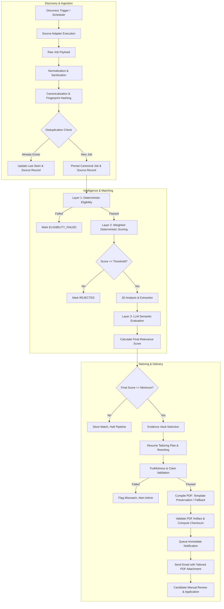

# AI Job Intelligence Platform — Job Processing Pipeline Design

**Document ID:** TD-004  
**Status:** Approved Technical Design  
**Date:** 2026-11-04  
**Scope:** Discovered Job Lifecycle, Deduplication Algorithms, Canonicalization Rules, and Pipeline Stages  

---

# 1. Executive Summary

This document details the end-to-end lifecycle of a discovered job within JobRadar AI. The pipeline transforms messy, disparate, and volatile upstream data from supported platforms (Greenhouse, Lever, permitted Career Pages) into reliable, normalized, and canonical job intelligence. It subsequently drives deterministic matching, LLM-powered semantic analysis, evidence-based truthful resume tailoring, PDF compilation, and immediate email notification.

The pipeline is architected around **strict idempotency**, **deterministic hashing**, and **durable state persistence**, ensuring zero duplicate jobs, zero fabricated data, and zero duplicate email notifications.

---

# 2. Pipeline Overview & Lifecycle Diagram



---

# 3. Job Entity Distinctions: Raw vs Normalized vs Canonical

To prevent data ambiguity, the platform distinguishes between three distinct representations of a job:

```text
┌─────────────────────────────────────────────────────────────────────────┐
│                              Raw Discovered Job                         │
│  - Exact upstream JSON payload or raw HTML snippet                      │
│  - Volatile, source-specific keys (e.g. greenhouse `id`, lever `text`)  │
│  - Preserved verbatim in `job_source_records.raw_payload`               │
└────────────────────────────────────┬────────────────────────────────────┘
                                     │
                                     ▼ Normalization Rules
┌─────────────────────────────────────────────────────────────────────────┐
│                            Normalized Job (DTO)                         │
│  - Cleaned text: UTF-8 normalized, HTML tags stripped, whitespace trimmed│
│  - Standardized workplace enum: REMOTE, HYBRID, ONSITE                 │
│  - Standardized employment enum: FULL_TIME, CONTRACT, etc.              │
│  - Standardized city, state, country formatting                         │
│  - Unambiguous timestamps: parsed `posted_at` (or NULL if absent)       │
└────────────────────────────────────┬────────────────────────────────────┘
                                     │
                                     ▼ Fingerprint Algorithm
┌─────────────────────────────────────────────────────────────────────────┐
│                            Canonical Job (Entity)                       │
│  - Deduplicated, globally unique opportunity in `jobs` table            │
│  - Identified by SHA256 deterministic fingerprint                       │
│  - Canonical application URL (all tracking parameters removed)          │
│  - Linked to one or more `job_source_records`                           │
└─────────────────────────────────────────────────────────────────────────┘
```

---

# 4. Canonicalization & Deduplication Strategy

Job discovery faces real-world challenges:
1. The exact same job is discovered repeatedly during subsequent polling cycles.
2. The same job is posted across multiple sources (e.g., both Greenhouse and a company career page).
3. Jobs are updated with minor edits to the description text.
4. Jobs are closed and reposted after several weeks.
5. Tracking identifiers (`utm_source`, `gh_jid`, session IDs) pollute URLs.

## 4.1 URL Sanitization Algorithm
Before evaluating identity, application URLs are cleaned using strict rules:
1. Strip all query parameters matching:
   `utm_*`, `gh_jid`, `lever-origin`, `lever-source`, `ref`, `source`, `fbclid`, `gclid`, `token`, `sid`.
2. Convert domain and path to lowercase.
3. Remove trailing slashes and default document names (e.g., `index.html`).
4. Enforce `https://` protocol.

## 4.2 Deduplication Fingerprint Formulations

The canonical identity of a job is determined by a deterministic SHA256 hash. The platform employs a **two-tier deduplication check**:

### Tier 1: Canonical Source Record Check (Fast Path)
A composite unique constraint on `(job_source_id, external_job_id)` prevents the same source adapter from creating duplicate records for identical job postings.

### Tier 2: Semantic Identity Fingerprint (Cross-Source & Cross-Time)
To detect the same job posted across different platforms or updated over time, a canonical fingerprint is computed:

```text
canonical_slug = 
    normalize_slug(company_name) + ":" +
    normalize_slug(job_title) + ":" +
    normalize_slug(location) + ":" +
    workplace_type.value

dedup_fingerprint_sha256 = SHA256(canonical_slug)
```

**Where `normalize_slug(text)`:**
1. Converts to lowercase.
2. Removes non-alphanumeric characters (except spaces).
3. Strips corporate suffixes: `"inc"`, `"incorporated"`, `"corp"`, `"corporation"`, `"llc"`, `"ltd"`, `"technologies"`.
4. Normalizes common title abbreviations: `"sr"` → `"senior"`, `"jr"` → `"junior"`, `"sw eng"` → `"software engineer"`.
5. Removes duplicate internal whitespace and converts spaces to hyphens.

### Example:
- **Source A:** `"Stripe, Inc."` | `"Sr. Backend Engineer - Payments"` | `"San Francisco, CA (Remote)"`
  - Normalized: `company="stripe"` | `title="senior backend engineer payments"` | `location="san francisco ca"` | `workplace="remote"`
  - `canonical_slug = "stripe:senior-backend-engineer-payments:san-francisco-ca:remote"`
- **Source B:** `"Stripe"` | `"Senior Backend Engineer, Payments"` | `"Remote - US"`
  - Normalized: `company="stripe"` | `title="senior backend engineer payments"` | `location="remote us"` | `workplace="remote"`
  - Matching engine detects matching company + title + workplace; if application URLs point to the same destination host, the system associates the job with the existing canonical job record.

## 4.3 Handling Updates, Reposts, and Closed Jobs

| Scenario | Detection Mechanism | System Action |
| :--- | :--- | :--- |
| **Identical Job Re-discovered** | Tier 1 or Tier 2 match found; description checksum identical. | Update `jobs.last_seen_at = NOW()`. Update `job_source_records.first_seen_at`. Skip matching and tailoring. |
| **Updated Description** | Fingerprint matches existing job; description text hash changed. | Update `jobs.description_text`, update `updated_at`. If job was already notified, do **not** re-notify unless significant requirements changed. |
| **Reposted Job (> 30 days gap)** | Fingerprint matches an archived/closed job where `last_seen_at < NOW() - 30 days`. | Revive canonical job (`status = 'DISCOVERED'`), set `first_seen_at = NOW()`, record new `job_source_record`. Re-evaluate matching rules. |
| **Closed / Missing Job** | Active job not present in source discovery run for 3 consecutive cycles. | Set `jobs.status = 'ARCHIVED'`. Prevents outdated jobs from surfacing in active searches. |

---

# 5. Granular Stage-by-Stage Specification

## Stage 1: Discovery & Ingestion
- **Input:** Source adapter configuration (e.g., Greenhouse board token: `stripe`).
- **Processing:** Source adapter calls public endpoint, handles rate limits, transforms HTTP response into a stream of `RawDiscoveredJob` DTOs.
- **Output:** List of `RawDiscoveredJob` objects.
- **Database Interaction:** Insert `discovery_runs` record with `status = 'RUNNING'`.
- **Idempotency:** Discovery run keyed by `run_id`.
- **Failure Behavior:** Network timeouts retried with backoff. If endpoint returns 404/403, mark `discovery_runs.status = 'FAILED'` with error details.
- **Observability:** Structured log: `discovery_run_started`, source name, response status code, elapsed milliseconds.

## Stage 2: Normalization & Canonicalization
- **Input:** `RawDiscoveredJob`.
- **Processing:**
  - Strip HTML and scripts from description using safe parser.
  - Parse `posted_at` to UTC `TIMESTAMPTZ` (set `NULL` if missing; never fabricate).
  - Clean application URL; strip tracking parameters.
  - Compute `dedup_fingerprint_sha256`.
- **Output:** `NormalizedJobDTO`.
- **Database Interaction:**
  - Query `jobs` for existing `dedup_fingerprint_sha256`.
  - If exists: Update `last_seen_at`, insert `job_source_records` if new source.
  - If new: Insert into `jobs` (`status = 'DISCOVERED'`), insert into `job_source_records`.
- **Idempotency:** Enforced via `uq_jobs_dedup_fingerprint` and `uq_job_source_record`.
- **Failure Behavior:** Malformed payloads discarded and logged to dead-letter queue.
- **Observability:** Log `job_normalized`, `job_id`, `dedup_fingerprint`, is_new (boolean).

## Stage 3: Deterministic Eligibility Evaluation (Layer 1)
- **Input:** `jobs.id`, `candidate_profile_id`.
- **Processing:**
  - Check hard constraints: Maximum job age (`max_job_age_days`), candidate location preferences, workplace compatibility (remote/onsite), minimum experience threshold.
- **Output:** `EligibilityResult` (`is_eligible: bool`, `reason: EligibilityStatusEnum`).
- **Database Interaction:** Insert or update `job_matches` record. If failed, update `jobs.status = 'ELIGIBILITY_FAILED'`.
- **Idempotency:** Re-running with same profile and job produces identical outcome.
- **Failure Behavior:** On logic error, task retries. If permanently ineligible, pipeline terminates cleanly for this job.
- **Observability:** Log `eligibility_evaluated`, `job_id`, `status`.

## Stage 4: Deterministic Weighted Matching (Layer 2)
- **Input:** Canonical job description, candidate skills, candidate profile.
- **Processing:**
  - Skill coverage calculation against normalized skill dictionary.
  - Experience score calculation.
  - Title similarity using trigram distance.
  - Compute `deterministic_score` (0.00 to 100.00).
- **Output:** `DeterministicMatchDTO` (scores, matched skills, missing skills).
- **Database Interaction:** Update `job_matches` with `deterministic_score`, `skill_score`, `experience_score`.
- **Idempotency:** Pure mathematical calculation.
- **Decision Gate:** If `deterministic_score < candidate_preferences.minimum_relevance_score - 15.0`:
  - Mark `jobs.status = 'REJECTED'`. Terminate pipeline (avoids wasting expensive LLM tokens on clearly irrelevant jobs).
- **Observability:** Log `deterministic_match_computed`, `job_id`, `score`.

## Stage 5: Job Description Analysis & LLM Semantic Evaluation (Layer 3)
- **Input:** Job description text, candidate profile summary and experiences.
- **Processing:**
  - Step 5A: Call `LLMProvider.complete_structured()` with strict JSON schema to extract structured JD requirements (required skills, preferred skills, responsibilities, seniority).
  - Step 5B: Call `LLMProvider` to evaluate contextual relevance, transferable skills, strengths, and risks.
  - Compute `final_score = (deterministic_score * 0.6) + (semantic_score * 0.4)`.
- **Output:** `job_analysis` record and `SemanticEvaluationDTO`.
- **Database Interaction:**
  - Insert or update `job_analysis`.
  - Update `job_matches` with `semantic_score`, `final_score`, `match_explanation`, `match_explanation_details`.
  - If `final_score >= candidate_preferences.minimum_relevance_score`: set `jobs.status = 'MATCHED'`.
  - Else: set `jobs.status = 'REJECTED'`.
- **Failure Behavior:** If LLM service times out or errors, fall back gracefully to `final_score = deterministic_score` and flag `match_explanation_details.llm_fallback = true`. Do not crash the pipeline.
- **Observability:** Log `llm_semantic_analysis_completed`, token usage, duration, score.

## Stage 6: Truthful Resume Tailoring
- **Input:** Matched `job_id`, active `resume_versions` record, candidate profile evidence.
- **Processing:**
  - Extract candidate evidence vault (all verified achievements and past bullets).
  - Construct section-by-section tailoring plan: re-order bullet points, select relevant projects, rephrase bullets emphasizing job keywords truthfully.
  - Validate generated claims against candidate evidence vault. Any claim containing unverified technologies or metrics is rejected.
- **Output:** `tailored_content` JSON.
- **Database Interaction:** Insert into `tailored_resumes` with `generation_status = 'PENDING'`, update `jobs.status = 'TAILORING'`.
- **Failure Behavior:** If claim validation detects fabrication, generation is aborted, logged with severity `WARNING`, and re-attempted with stricter constraints.
- **Observability:** Log `resume_tailoring_completed`, `job_id`, bullet_count, validated (bool).

## Stage 7: PDF Generation & Verification
- **Input:** `tailored_content` JSON, active resume template metadata.
- **Processing:**
  - Determine rendering strategy:
    - If master resume is standard DOCX/HTML or supported PDF layout: Compile via `template_preserver` engine.
    - If master resume layout is complex/unsupported: Compile via `fallback_renderer` (clean ATS template).
  - Compile HTML/CSS into PDF binary via WeasyPrint.
  - Calculate SHA256 checksum of generated PDF binary.
  - Validate PDF: Verify file size > 5KB, verify PDF header (`%PDF-`), verify text extraction with `pdfplumber`.
  - Save PDF to storage (`resumes/tailored/<uuid>.pdf`).
- **Output:** `storage_key`, `checksum_sha256`.
- **Database Interaction:** Update `tailored_resumes` with `storage_key`, `checksum_sha256`, `generation_status = 'VALIDATED'`. Update `jobs.status = 'TAILORED'`.
- **Failure Behavior:** If PDF compilation fails, retry once using the standardized fallback template. If that fails, set `generation_status = 'FAILED'`.
- **Observability:** Log `pdf_generated`, file size, render strategy used, duration.

## Stage 8: Immediate Email Notification Delivery
- **Input:** `job_id`, `tailored_resume_id`, candidate email.
- **Processing:**
  - Query database to ensure notification does not already exist for `(job_id, recipient_email)`.
  - Assemble multipart MIME email: HTML body containing job details, match score breakdown, strengths, direct application link, and attached tailored PDF resume.
  - Transmit via `EmailProvider.send_email()`.
- **Output:** SMTP message ID / delivery confirmation.
- **Database Interaction:**
  - Insert into `notification_deliveries` with `status = 'SENDING'`.
  - On success: Update `status = 'DELIVERED'`, set `sent_at = NOW()`, update `jobs.status = 'NOTIFIED'`.
  - On failure: Update `status = 'FAILED'`, record `last_error`, increment `attempt_count`.
- **Idempotency:** Compound unique constraint prevents duplicate dispatch.
- **Failure Behavior:** Retry via Celery with exponential backoff (up to 5 attempts). Failed email delivery does not invalidate the generated resume or job match.
- **Observability:** Log `notification_delivered`, `job_id`, `recipient`, `provider_message_id`.

---

# 6. Pipeline Resilience & Circuit Breaking

```text
┌───────────────────────┬──────────────────────┬────────────────────────────────────────────────────────┐
│ Failure Point         │ Max Retries          │ Recovery / Fallback Behavior                            │
├───────────────────────┼──────────────────────┼────────────────────────────────────────────────────────┤
│ Source Adapter (HTTP) │ 3 (Backoff: 10s-60s) │ Mark run 'FAILED', preserve already discovered jobs.   │
│ Normalizer Parse      │ 0                    │ Drop corrupt payload, log schema error to dead letter. │
│ LLM JD Extraction     │ 2 (Backoff: 5s)      │ Fallback to regex-based skill extraction.              │
│ LLM Semantic Analysis │ 1 (Backoff: 5s)      │ Graceful degradation: use deterministic score only.    │
│ PDF Template Preserve │ 1 (Immediate)        │ Fallback immediately to standard ATS template.        │
│ WeasyPrint Binary     │ 1 (Backoff: 5s)      │ Re-render with minimal CSS fallback.                  │
│ SMTP Email Server     │ 5 (Backoff: 5s-300s) │ Celery auto-retry; keep tailored PDF safely stored.    │
└───────────────────────┴──────────────────────┴────────────────────────────────────────────────────────┘
```

