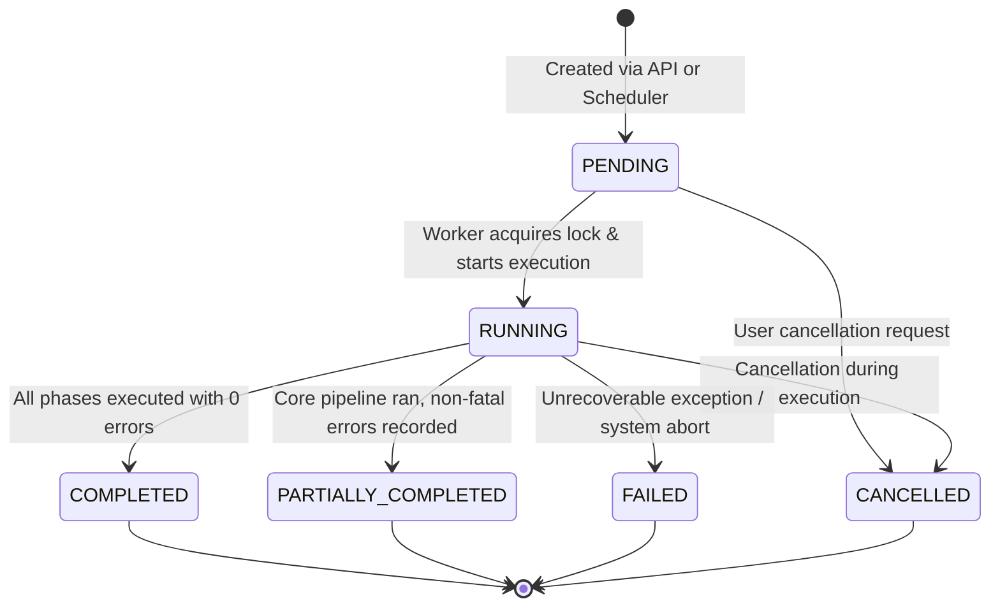

# JobRadar AI — Pipeline Orchestration, Scheduling & Operational Reliability (Milestone 10)

## 1. Executive Summary

Milestone 10 introduces the master orchestration layer into JobRadar AI. It binds together all previously isolated subsystem domains—Discovery, Canonicalization, Deterministic Matching, LLM Semantic Analysis, Truthful Resume Tailoring, and Immediate Email Notification—into an observable, persistent, scheduled, and reliable end-to-end execution pipeline.

```text
Scheduled / Manual Trigger
            ↓
  PipelineRun Created (PENDING)
            ↓
Dispatched to Celery (202 Accepted)
            ↓
Distributed Lock Acquired + State -> RUNNING
            ↓
Job Discovery (Greenhouse, Lever)
            ↓
Job Normalization, Deduplication & Canonical Storage
            ↓
Deterministic Matching (Layer 1 & 2)
            ↓
Semantic Analysis (Layer 3 LLM) for Qualified Matches
            ↓
Resume Tailoring & PDF Generation / Validation
            ↓
Immediate Email Notification with PDF Attachment
            ↓
Operational Metrics Aggregated (Atomic Increments)
            ↓
Finalize Status (COMPLETED / PARTIALLY_COMPLETED / FAILED / CANCELLED)
```

---

## 2. Architecture Overview & Execution Phases

The orchestration service coordinates execution across five distinct, bounded phases while strictly respecting domain boundaries (the pipeline orchestrates, but domain services retain ownership of business rules):

### Phase 1: Job Discovery
- Identifies active, enabled `JobSource` entities.
- Invokes source-specific discovery adapters (Greenhouse, Lever).
- Persists raw job payloads idempotently using SHA-256 deduplication.
- Updates atomic metrics: `jobs_discovered`, `jobs_created`, `jobs_updated`.

### Phase 2: Normalization & Canonicalization
- Processes pending raw records via `JobService.process_pending_records`.
- Normalizes titles, locations, workplace types, and skills.
- Deduplicates postings across sources using company domain and URL canonicalization.
- Updates atomic metrics: `jobs_normalized`, `jobs_deduplicated`.

### Phase 3: Deterministic Candidate Matching (Layer 1 & Layer 2)
- Queries active candidate profiles and preferences.
- Identifies unmatched canonical jobs.
- Evaluates Layer 1 hard constraints (eligibility rules).
- Calculates Layer 2 deterministic weighted scores (skills, experience, title, workplace).
- Updates atomic metrics: `jobs_evaluated`, `matches_created`, `matches_qualified`.

### Phase 4: LLM Semantic Evaluation & Resume Tailoring
- For qualified matches ($\ge 60.00$), executes Layer 3 LLM Semantic Analysis.
- Gracefully degrades to deterministic score if the LLM is unreachable or times out.
- Enqueues truthful resume tailoring for qualified matches.
- Enforces strict Evidence Vault claim validation against candidate history.
- Compiles ATS-compliant single-column PDF artifacts.
- Updates atomic metrics: `semantic_analyses_completed`, `semantic_analyses_failed`, `resumes_generated`, `resumes_failed`.

### Phase 5: Notification Delivery & Finalization
- For completed tailored resumes, dispatches immediate email notifications with the PDF attached via `NotificationService`.
- Aggregates delivery status and increments `notifications_sent` or `notifications_failed`.
- Evaluates operational error thresholds and transitions the run to its terminal state:
  - `COMPLETED`: All phases and items succeeded without error.
  - `PARTIALLY_COMPLETED`: Core pipeline ran, but individual jobs/resumes failed validation or non-fatal errors occurred.
  - `FAILED`: Critical failure prevented pipeline execution.
  - `CANCELLED`: User or system aborted an active run.

---

## 3. Database Schema & Migration

### Migration Reference
`backend/alembic/versions/20261105_0010_pipeline_runs.py`

### Table: `pipeline_runs`

| Column | Type | Constraints / Modifiers | Description |
|---|---|---|---|
| `id` | `UUID` | Primary Key, default `uuid4` | Unique pipeline run identifier |
| `candidate_profile_id` | `UUID` | FK `candidate_profiles.id` ON DELETE CASCADE | Associated candidate profile |
| `trigger_type` | `pipeline_trigger_type_enum` | NOT NULL | `MANUAL`, `SCHEDULED`, `API` |
| `status` | `pipeline_run_status_enum` | NOT NULL, default `PENDING` | `PENDING`, `RUNNING`, `COMPLETED`, `PARTIALLY_COMPLETED`, `FAILED`, `CANCELLED` |
| `started_at` | `TIMESTAMPTZ` | NULL | Timestamp when worker began processing |
| `completed_at` | `TIMESTAMPTZ` | NULL | Timestamp when terminal state was reached |
| `jobs_discovered` | `INTEGER` | NOT NULL, default `0` | Total raw jobs fetched from adapters |
| `jobs_created` | `INTEGER` | NOT NULL, default `0` | New raw job records created |
| `jobs_updated` | `INTEGER` | NOT NULL, default `0` | Existing raw job records updated |
| `jobs_normalized` | `INTEGER` | NOT NULL, default `0` | Raw records converted to canonical jobs |
| `jobs_deduplicated` | `INTEGER` | NOT NULL, default `0` | Postings deduplicated against existing jobs |
| `jobs_evaluated` | `INTEGER` | NOT NULL, default `0` | Postings evaluated against candidate profile |
| `matches_created` | `INTEGER` | NOT NULL, default `0` | Total `JobMatch` records created or updated |
| `matches_qualified` | `INTEGER` | NOT NULL, default `0` | Matches meeting qualification criteria |
| `semantic_analyses_completed` | `INTEGER` | NOT NULL, default `0` | Layer 3 LLM analyses successfully completed |
| `semantic_analyses_failed` | `INTEGER` | NOT NULL, default `0` | Layer 3 LLM analyses failed or degraded |
| `resumes_generated` | `INTEGER` | NOT NULL, default `0` | Tailored ATS PDF resumes compiled & stored |
| `resumes_failed` | `INTEGER` | NOT NULL, default `0` | Tailoring attempts rejected or failed |
| `notifications_sent` | `INTEGER` | NOT NULL, default `0` | Alert emails successfully dispatched |
| `notifications_failed` | `INTEGER` | NOT NULL, default `0` | Alert emails that failed delivery |
| `error_summary` | `VARCHAR(1000)` | NULL | Aggregated summary of non-fatal errors |
| `run_metadata` | `JSONB` | NOT NULL, default `{}` | Execution context and diagnostics |
| `created_at` | `TIMESTAMPTZ` | NOT NULL, default UTC now | Audit timestamp |
| `updated_at` | `TIMESTAMPTZ` | NOT NULL, default UTC now | Audit timestamp |

### Indexes & Integrity Constraints
1. **Partial Unique Index (Database-Level Concurrency Guard):**
   ```sql
   CREATE UNIQUE INDEX uq_pipeline_runs_active_candidate
   ON pipeline_runs (candidate_profile_id)
   WHERE status IN ('PENDING', 'RUNNING');
   ```
   Guarantees at the storage engine level that a candidate profile can never have more than one active pipeline run at any moment.
2. **Status Index:** `ix_pipeline_runs_status` on `(status)`.
3. **Candidate Index:** `ix_pipeline_runs_candidate_profile_id` on `(candidate_profile_id)`.
4. **Creation Timestamp Index:** `ix_pipeline_runs_created_at` on `(created_at)`.

---

## 4. Concurrency Protection & Atomic Metrics

### Distributed Locking
- Each pipeline run execution is guarded by a Redis distributed lock:
  ```text
  lock:pipeline_run:{run_id} (TTL: 600s)
  ```
- If a worker crashes, the lock automatically expires after 10 minutes, preventing permanent deadlocks.
- The lock is acquired when transitioning to `RUNNING` and released in a `finally` block upon completion.

### Atomic Operational Counters
Metrics counters are updated via atomic SQL arithmetic, preventing lost-update race conditions:
```python
stmt = (
    update(PipelineRun)
    .where(PipelineRun.id == run_id)
    .values(
        jobs_discovered=PipelineRun.jobs_discovered + jobs_discovered,
        jobs_created=PipelineRun.jobs_created + jobs_created,
        resumes_generated=PipelineRun.resumes_generated + resumes_generated,
        ...,
        updated_at=datetime.now(UTC),
    )
)
```

---

## 5. State Machine Lifecycle



### Transition Invariants
- `PENDING` $\rightarrow$ `RUNNING`, `CANCELLED`
- `RUNNING` $\rightarrow$ `COMPLETED`, `PARTIALLY_COMPLETED`, `FAILED`, `CANCELLED`
- Terminal states (`COMPLETED`, `PARTIALLY_COMPLETED`, `FAILED`, `CANCELLED`) are immutable and strictly disallow any further state transitions.

---

## 6. Scheduling Architecture & Dual-Mode Deployment

JobRadar AI supports two scheduling topologies:

### 1. Local-First Standalone Scheduler Daemon
- File: `backend/app/modules/pipeline/scheduler.py`
- Runs as an independent process: `python -m app.modules.pipeline.scheduler`
- Uses Redis leader election (`lock:pipeline_scheduler:leader`, TTL 30s, refreshed every 10s) to guarantee only one scheduler instance is active in multi-worker environments.
- Periodically queries candidate profiles needing pipeline evaluation and enqueues Celery tasks.

### 2. Celery Beat Periodic Tasks
- File: `backend/app/workers/celery_app.py`
- Beat schedule:
  - `process-pending-raw-jobs`: Runs every 120s.
  - `schedule-candidate-pipeline-runs`: Runs every 300s.

---

## 7. Operational Health Endpoints

- `GET /health` and `GET /api/v1/health`: Basic liveness check returning status, version, and environment.
- `GET /ready` and `GET /api/v1/ready`: Comprehensive operational readiness check testing live connectivity to:
  - **PostgreSQL Database** (`SELECT 1`)
  - **Redis Broker / Cache** (`PING`)
  - **Ollama LLM Service** (reachability check; non-blocking warning if offline due to graceful degradation)

---

## 8. REST API Reference

| Method | Path | Status | Description |
|---|---|---|---|
| `POST` | `/api/v1/pipeline-runs` | `202 Accepted` | Trigger a new pipeline run (manual or API) |
| `GET` | `/api/v1/pipeline-runs` | `200 OK` | List pipeline runs with status and candidate filters |
| `GET` | `/api/v1/pipeline-runs/{id}` | `200 OK` | Fetch detailed pipeline run status and metrics |
| `POST` | `/api/v1/pipeline-runs/{id}/cancel` | `200 OK` | Abort an active or pending pipeline run |
| `GET` | `/health` | `200 OK` | Root liveness endpoint |
| `GET` | `/ready` | `200 OK` / `503` | Root readiness endpoint with dependency health |

