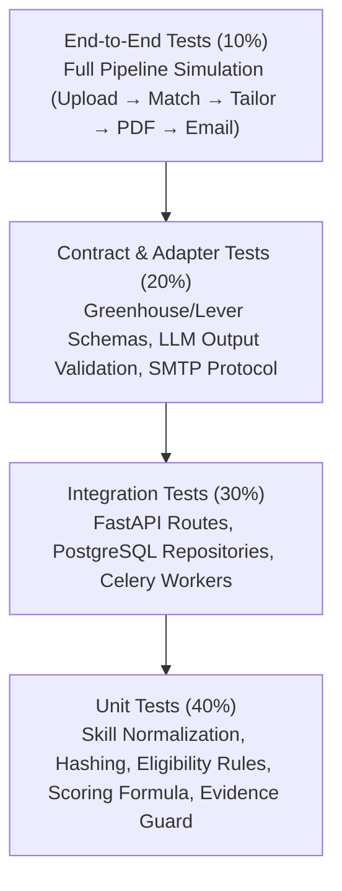
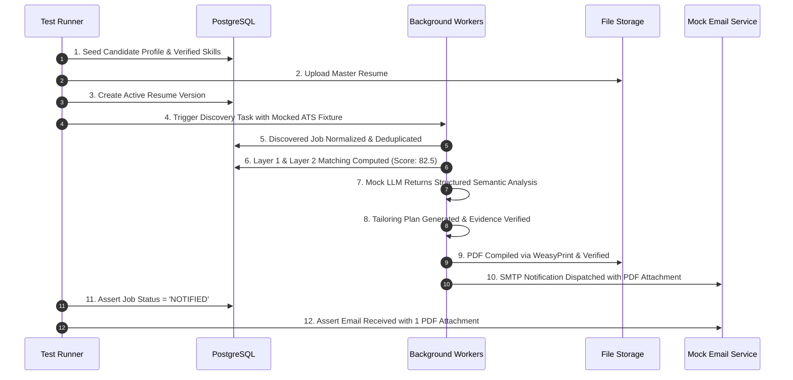

# AI Job Intelligence Platform — Comprehensive Testing Strategy

**Document ID:** TD-008  
**Status:** Approved Technical Design  
**Date:** 2026-11-04  
**Scope:** Testing Pyramid, Unit Tests, Integration Tests, Contract Tests, E2E Pipelines, and Mocking Architecture  

---

# 1. Executive Summary & Quality Principles

To guarantee that JobRadar AI functions reliably without regression, hallucination, or data loss, this document establishes the platform's **Automated Testing Strategy**.

### Core Testing Invariants:
1. **Deterministic Test Execution:** Tests must run deterministically. No flaky network calls or real LLM token charges occur during automated test suites.
2. **Strict Test Pyramid:** Fast, isolated unit tests form the foundation; integration tests validate database and API contracts; end-to-end tests verify end-to-end user workflows.
3. **Evidence Protection Testing:** Resume tailoring tests verify that claims are strictly supported by candidate evidence and that any fabricated metrics or technologies are rejected.
4. **Idempotency Verification:** Background worker tests explicitly simulate retries and crashes to verify that duplicate jobs, resumes, and emails are impossible.
5. **Fast Feedback Loop:** The unit test suite executes in under 10 seconds locally to support rapid developer workflows.

---

# 2. Testing Pyramid & Test Architecture



| Layer | Proportion | Execution Time | External Dependencies | Primary Objective |
| :--- | :--- | :--- | :--- | :--- |
| **Unit Tests** | ~40% | < 50ms per test | None (Pure Python) | Algorithmic correctness, parsing rules, math formulas |
| **Integration Tests** | ~30% | 50ms - 300ms | PostgreSQL, Redis (Local Docker) | Database transactions, API contracts, worker queues |
| **Contract Tests** | ~20% | 100ms - 500ms | Mocked HTTP (`respx`, VCR fixtures) | Adapter parsing fidelity, LLM JSON schema compliance |
| **E2E Tests** | ~10% | 1s - 5s per test | Test DB, Test Broker, Test Storage | Full candidate journey from discovery to email alert |

---

# 3. Unit Testing Strategy

Unit tests reside in `tests/unit/` and evaluate pure functions without database or network I/O.

## 3.1 Critical Unit Test Suites

### 1. Skill Normalization & Alias Engine (`tests/unit/test_skill_normalizer.py`)
- **Scenarios:**
  - Standard aliases map to canonical form (`"postgresql"`, `"postgres"`, `"psql"` → `"postgresql"`).
  - Punctuation and casing normalization (`"Node.JS"` → `"nodejs"`, `"C++"` → `"cpp"`).
  - Unrecognized novel skills pass through as sanitized lowercased strings.
  - Multi-word technologies map correctly (`"Amazon Web Services"` → `"aws"`).

### 2. Job Canonicalization & Hashing (`tests/unit/test_job_deduplicator.py`)
- **Scenarios:**
  - URL tracking parameters stripped (`utm_source`, `gh_jid`, `token`).
  - Company suffix removal (`"Stripe Inc."` vs `"Stripe LLC"` produces identical canonical slug).
  - Job title normalization (`"Sr. Backend Eng"` vs `"Senior Backend Engineer"` produces identical slug).
  - Deterministic SHA256 fingerprint generation is reproducible across platforms.

### 3. Layer 1 Eligibility Rules (`tests/unit/test_eligibility.py`)
- **Scenarios:**
  - Freshness check rejects jobs older than `max_job_age_days`.
  - Location incompatibility (candidate `REMOTE`-only rejected by `ONSITE` job).
  - Minimum experience check respects the 12-month grace buffer.
  - Work authorization constraints trigger `INELIGIBLE_WORK_AUTH`.

### 4. Layer 2 Weighted Scoring Formula (`tests/unit/test_scoring.py`)
- **Scenarios:**
  - Perfect skill overlap returns 40.00 skill points.
  - Partial skill overlap calculates correct mathematical ratios.
  - Title similarity using trigram distance rewards close job titles.
  - Final deterministic score clamps cleanly between `0.00` and `100.00`.

### 5. Truthful Resume Evidence Validator (`tests/unit/test_evidence_validator.py`)
- **Scenarios:**
  - Rewritten bullet points containing only verified candidate facts are approved.
  - Hallucinated technology claims (e.g. adding `"Kubernetes"` when candidate only knows `"Docker"`) fail validation.
  - Exaggerated metrics (e.g. changing `"improved latency by 15%"` to `"improved latency by 85%"`) fail validation.

---

# 4. Integration Testing Strategy

Integration tests reside in `tests/integration/` and run against isolated PostgreSQL and Redis instances.

## 4.1 Database & Repository Testing
- **Harness:** Tests run within isolated PostgreSQL transactions rolled back after each test function (`pytest` fixture using `async with connection.begin():`).
- **Alembic Migration Verification:** A dedicated test executes `alembic upgrade head` and `alembic downgrade base` to ensure migration scripts execute cleanly without syntax errors or foreign key deadlocks.
- **Cascading Integrity:** Deleting a candidate profile cascades cleanly to skills, preferences, and matches.

## 4.2 FastAPI Endpoint Testing (`tests/integration/test_api_*.py`)
- **Client:** `httpx.AsyncClient` communicating directly with `app` via ASGI transport.
- **Coverage:**
  - `POST /api/v1/resumes/upload`: Multipart upload creates `master_resumes` record and triggers background parsing.
  - `GET /api/v1/jobs`: Query filtering by workplace type, status, and trigram search works accurately.
  - `PUT /api/v1/candidate/preferences`: Rejects invalid scores (< 0 or > 100) with RFC 7807 422 payload.

## 4.3 Celery Task Execution Testing (`tests/integration/test_worker_tasks.py`)
- **Mode:** Celery configured with `task_always_eager = True` for synchronous execution during integration testing.
- **Idempotency Tests:**
  - Executing `process_discovered_job_task` twice with the same external ID updates `last_seen_at` without duplicating rows.
  - Executing `send_email_notification_task` twice sends exactly one email and marks the record `DELIVERED`.

---

# 5. Contract & External Adapter Testing

Contract tests reside in `tests/contract/` and verify that the platform correctly interacts with third-party formats.

## 5.1 Source Adapters (Greenhouse & Lever)
- **Tool:** `respx` (for mocking HTTP responses) and stored JSON fixtures (`tests/fixtures/greenhouse_sample.json`, `tests/fixtures/lever_sample.json`).
- **Verification:**
  - Adapters parse actual upstream response payloads accurately.
  - Upstream schema changes (e.g. missing `location` object) trigger graceful fallbacks rather than unhandled key errors.
  - Rate limiting HTTP 429 responses trigger expected backoff signals.

## 5.2 LLM Provider Contract Tests (`tests/contract/test_llm_provider.py`)
- **Mock Implementation:** `MockLLMProvider` simulating:
  - Valid structured JSON responses.
  - Malformed JSON responses (verifying the automatic single repair prompt retry).
  - Network timeouts (verifying fallback to deterministic scoring).
- **Schema Conformity:** Validates that output strings deserialize cleanly into `SemanticEvaluationOutput` and `JobAnalysisOutput` Pydantic models.

## 5.3 Email & Storage Adapters
- **Storage:** Local filesystem adapter verified against temporary directories (`tmp_path`).
- **Email:** In-memory SMTP test handler captures outbound MIME messages and verifies:
  - Subject line formatting.
  - Multipart HTML body containing match breakdown.
  - Attachment binary is valid PDF data (`bytes[:4] == b'%PDF'`).

---

# 6. End-to-End Workflow Testing

End-to-end tests reside in `tests/e2e/test_end_to_end_pipeline.py` and validate the complete product journey without manual intervention:



---

# 7. Test Data Management & Factories

To avoid brittle, hard-coded JSON payloads in test files, the platform uses **Pydantic Model Factories**:

```python
# tests/factories/job_factory.py
class JobFactory:
    @staticmethod
    def create_raw_job(
        title="Senior Python Backend Engineer",
        company="Acme Corp",
        location="Remote",
        **overrides
    ) -> dict:
        return {
            "id": "gh-99821",
            "title": title,
            "company_name": company,
            "location": {"name": location},
            "content": "We are seeking a Senior Python Engineer with FastAPI, PostgreSQL, and Docker experience...",
            **overrides
        }
```

---

# 8. Test Execution Commands & CI Pipeline

```bash
# 1. Run ultra-fast unit test suite (target: < 10 seconds)
pytest tests/unit/

# 2. Run integration tests against local test database
pytest tests/integration/

# 3. Run full test suite with branch coverage report
pytest --cov=app --cov-report=term-missing --cov-fail-under=85 tests/

# 4. Run static linting and type checking
ruff check app/ tests/
ruff format --check app/ tests/
mypy --strict app/
```

